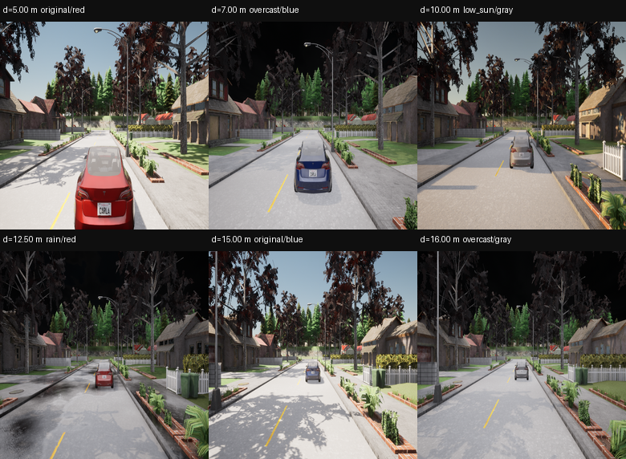
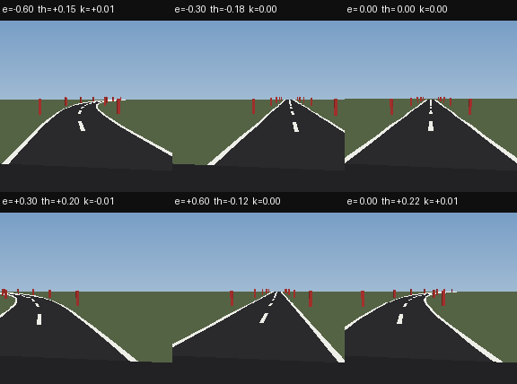
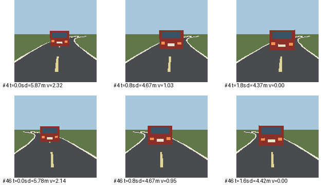
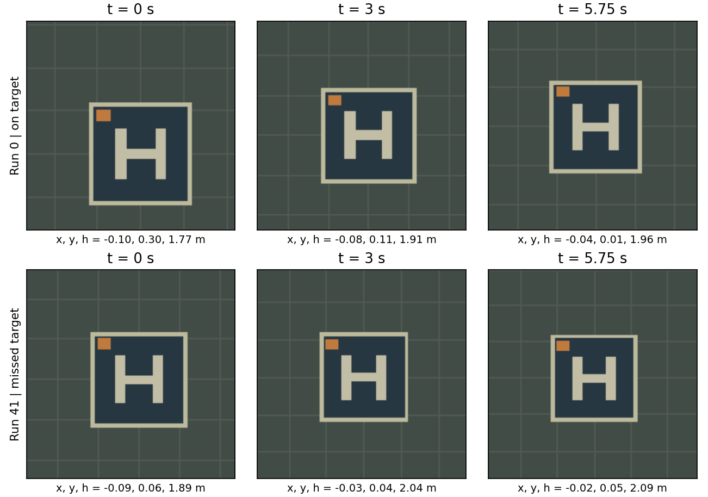
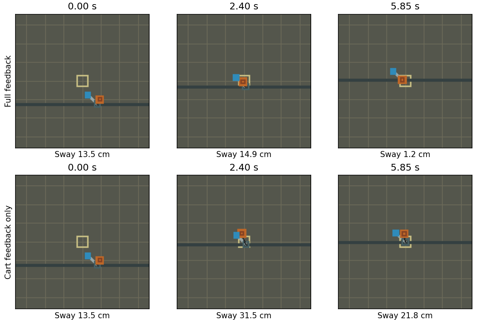
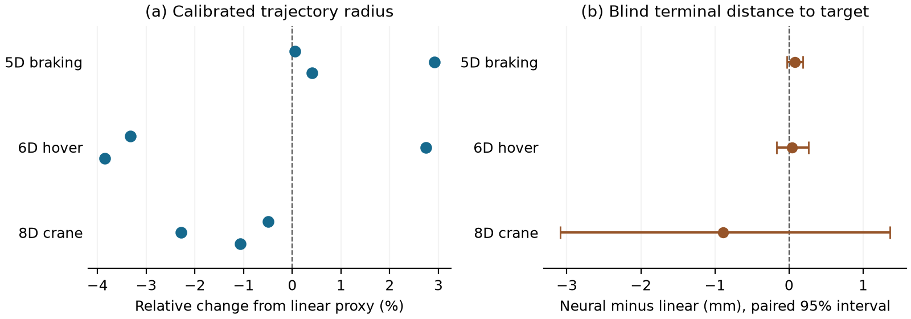
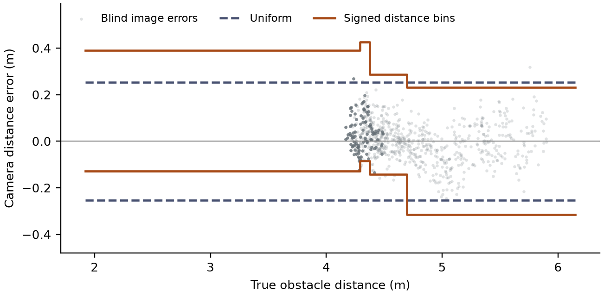
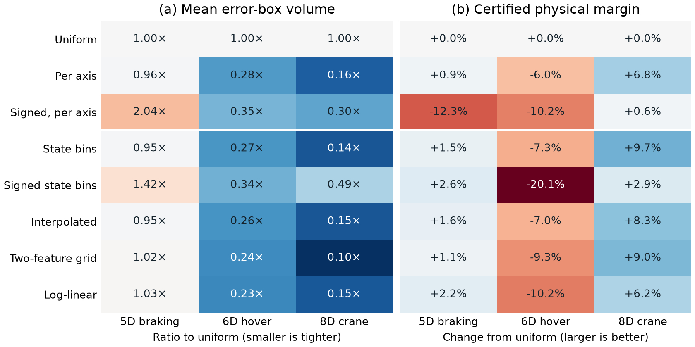

# 从自动紧急制动与车道保持到三个新增场景：状态、观测代理与安全保证

导师阶段汇报 · 2026 年 11 月 17 日　｜　[配套口头稿](导师汇报口头稿_从灰度制动到视觉闭环安全验证_20261117.md)

## 五个实验的状态怎么读？

下表用 $\mathbf{x}_t$ 表示第 $t$ 步的**完整物理状态**。第二列回答“仿真需要记录什么”，第三列回答“相机要看出什么”。带帽子的符号表示估计值，例如 $\hat d$ 是相机估计的距离，$d$ 是仿真中的真实距离。表内分量省略时间下标。

| 场景 | 完整物理状态 $\mathbf{x}_t$ | 相机估计的物理量 | 控制时另外知道什么 |
|---|---|---|---|
| 原实验 1 · 自动紧急制动（2 维） | $(d,v)$ | $d$：与前方目标的距离（m） | $v$：实测车速（m/s） |
| 原实验 2 · 车道保持（2 维） | $(e,\theta)$ | $e$：相对车道中心的横向偏差（m）；$\theta$：车头相对道路切线的航向偏差（rad） | 道路曲率 $\kappa$（m⁻¹）已知，车速固定为 4 m/s |
| 新增 · 弯道遇障制动（5 维） | $(e,\psi,d,v,\delta)$ | $e$：横偏（m）；$\psi$：航向偏差（rad）；$d$：车身中心到障碍物后表面的沿道距离（m） | $v$：车速（m/s）；$\delta$：当前实际前轮转角（rad）；曲率 $\kappa$ 已知 |
| 新增 · 无人机悬停（6 维） | $(p_x,p_y,p_z,v_x,v_y,v_z)$ | $p_x,p_y,p_z$：相对悬停目标的三轴位移（m） | $v_x,v_y,v_z$：三轴实测速度（m/s） |
| 新增 · 起重机消摆（8 维） | $(p_x,v_x,s_x,r_x,p_y,v_y,s_y,r_y)$ | 对两根水平轴 $i\in\{x,y\}$，$p_i$ 是小车相对目标的位置（m），$s_i$ 是吊载相对小车的摆移（m） | $v_i$ 是小车速度（m/s），$r_i$ 是吊载相对小车的摆速（m/s） |

车道模型的 $\theta$ 与弯道制动模型的 $\psi$ 都表示车头相对道路的航向偏差，沿用各自实验记号。无人机的 $p_z=0$ 表示到达目标高度 2 m；起重机吊载的位置要用 $p_i+s_i$ 算出。下文将 $Cx$ 里的列向量记作 $x_{\mathrm{obs}}$，以便和完整物理状态 $\mathbf{x}_t$ 区分。它列出状态侧用来预测视觉读数的分量，各实验的取法和尺度见各自状态表下方。训练与校准时可从仿真状态或图像标签得到这些真值；实际控制时图像分支从相机得到低维读数 $y$。

## 一、原来的两个实验：先把制动和转向分别跑通

### 实验 1　自动紧急制动（AEBS）

**本实验的状态向量**　$\mathbf{x}_t=(d,v)$

| 状态符号 | 物理含义 | 单位 | 控制器从哪里取得这个量 |
|---|---|---|---|
| $d$ | 与前方目标的距离 | m | 按当前车距、天气和车色从冻结的 CARLA 图库取前视图，由 DINO 距离头估计。 |
| $v$ | 本车纵向速度 | m/s | 由仿真车辆动力学更新，作为无测量误差的车速读数直接传给策略。 |

真实距离 $d$ 用于选图和核算误差；策略收到的是图像估计 $\hat d$ 的归一化值和车速 $v$。 [回放取图与观测来源](../../artical-F122/Aebs/vision_sls/replay_trajectory_cp.py) · [车距、车速更新与策略输入](../../artical-F122/Aebs/vision_sls/rollout.py)

**本实验的 $Cx$。** $x_{\mathrm{obs}}=(d/S,\ v)^\top$，$C$ 为 $1\times2$，输出一个名义视觉读数。$S$ 是视觉前端的距离尺度（RGB 版约 3.18272 m，灰度联合版约 3.23781 m）；$v$ 直接取以 m/s 表示的数值。

- **本节 RGB 基线**固定 $C=[1,0]$，所以 $Cx_{\mathrm{obs}}=d/S$。实际起作用的只有距离；车速通过单独的测速通道送给制动策略。
- **联合学习版**用 $C_d d/S+C_vv$。训练图只有距离标签，同图配 0、1.5、3 m/s 三个辅助速度；执行时用实测车速解码距离。RGB 版学得 $C_v\approx-0.00000844$，所以速度在名义视觉读数中的贡献很小。
- **RGB 神经代理静态对照**在上述线性项上加 $r_\phi(d/S)$；额外的神经网络只读取距离。[联合训练的输入与尺度](../experiments/跨实验对照/联合学习视觉投影与C_实验步骤与结果_20261109.md) · [训练代码](../../artical-F122/Aebs/vision_sls/train_joint_observation.py) · [神经残差的输入](../experiments/AEBS/非线性神经观察代理_论文依据与RGB试验_20261115.md)

*图 1　不同车距、天气和车辆外观下的 CARLA 前视样例。图像用来估计车距，速度从另一条测量通道输入控制器。*

1. **任务和动作。** 车从 $d\in[15,16]$ m、$v\in[2.5,3]$ m/s 出发，每 0.05 s 决定一次纵向指令 $a$（m/s²，正值表示制动）。目标是在进入 5–6 m 距离区间时将速度降到 0.5 m/s 及以下。车在远处提前停住也安全，却没有完成这个任务。
2. **视觉与控制怎样接起来。** 最早的 400 张灰度图验证了一维估距能接回制动策略；换成 24,000 张 CARLA 原始 RGB 图后，图像经 DINO 和视觉投影得到 $\hat d$，策略读取 $(\hat d,v)$ 后输出 $a$。每次刹车会改变下一步的真实车距，再按该车距、当趟天气和车色从固定图库取图。
3. **得到的结果。** 在最初完整的 RGB 基线中，冻结策略，用 199 趟行驶校准全程最大绝对测距误差，再验证神经鲁棒屏障。半径 **0.4184 m** 下条件安全检查通过；独立 100 趟中，**99 趟**的误差全程在界内，**100 趟**完成制动。后文的 ±0.45 m 是后续配对比较使用的控制器容许量。[灰度与 RGB 前端记录](../experiments/AEBS/AEBS前端对比_cGAN_灰度_真实RGB_20261108.md) · [RGB 基线完整报告](../experiments/AEBS/AEBS真实RGB图像_完整实验_20261108.md)

### 实验 2　车道保持

**本实验的状态向量**　$\mathbf{x}_t=(e,\theta)$

| 状态符号 | 物理含义 | 单位 | 控制器从哪里取得这个量 |
|---|---|---|---|
| $e$ | 车身参考点相对车道中心线的横向偏差 | m | 由当前状态渲染的前视车道图，经 DINO 图块特征和视觉投影估计。 |
| $\theta$ | 车头相对当前道路切线的航向偏差 | rad | 由同一帧前视图估计，道路边线的方向提供航向信息。 |

策略读取归一化的 $(\hat e,\hat\theta)$ 和场景给定的道路曲率 $\kappa$（m⁻¹）；车速固定为 4 m/s。前轮转角 $\phi$（rad）是策略输出。 [车辆状态、单位与动力学](../../artical-F122/Aebs/lane_keeping/core.py) · [相机、视觉估计与策略输入](../../artical-F122/Aebs/lane_keeping/trajectory_cp.py)

**本实验的 $Cx$。** $x_{\mathrm{obs}}=(e/(0.85\,\mathrm m),\ \theta/(0.30\,\mathrm{rad}))^\top$，两个分量均为无量纲数。$C$ 为 $2\times2$，输出两个数。最初基线取 $C=I_2$；后续可训练 $C$，或再接可逆网络 $H(Cx_{\mathrm{obs}})$。这三种版本使用相同的横偏和航向输入。曲率 $\kappa$ 单独送给转向策略，固定车速只用于车辆动力学。[线性代理实现](../../artical-F122/Aebs/lane_keeping/joint_observation.py) · [可逆神经代理实现](../../artical-F122/Aebs/lane_keeping/nonlinear_observation.py)

*图 2　边线相对画面中心的位置和方向共同提供横偏与航向信息。车每次转向后，按实际到达的状态重新渲染下一帧。*

1. **任务和动作。** 以 4 m/s 在直道、左弯或右弯上行驶 8 秒。每趟的已知曲率 $\kappa$ 取 $0$ 或 $\pm0.01$ m⁻¹，每 0.1 s 更新一次前轮转角 $\phi$（rad）。起点横偏在 ±0.25 m 内，航向偏差在 ±0.06 rad 内；观察 80 步中能否持续将横偏保持在 ±0.85 m、航向偏差保持在 ±0.30 rad 的边界内。
2. **视觉与控制怎样接起来。** 保留 DINO 图块的空间位置，由画面估计 $(\hat e,\hat\theta)$。神经策略接收这两个量的归一化值和曲率 $\kappa$，输出转向指令。这里的 $\phi$ 是动作；到了下面的五维制动实验，实际轮角 $\delta$ 会从上一步延续到下一步，因此还要作为状态记下来。
3. **得到的结果。** 固定前端和策略，按 199 条完整轨迹重新校准。所得归一化半径 **0.090093** 对应横偏误差约 **±7.66 cm**、航向误差约 **±1.55°**。同一批 100 趟测试，旧半径 0.08 全程覆盖 **82 趟**，新半径覆盖 **95 趟**；**100 趟**实际均未越界。原神经屏障在新半径和三个曲率下均通过。这也是后文比较线性代理与神经代理的基准任务。[车道控制器与动作定义](../experiments/车道保持/车道PPO_训练流程约束与CP误差说明_20261116.md) · [车道轨迹校准与验证结果](../experiments/车道保持/车道保持_轨迹级CP校准与SBC衔接_20261107.md)

## 二、新增的三个实验，各自在检验什么？

原来的自动紧急制动（AEBS）主要用图像估计一个量，即与前车的距离。这次让相机分别估计 **3 个、3 个、4 个量**，检验视觉误差怎样影响刹车、悬停和消摆。**五维、六维、八维指完整动力学状态的维数**，还包括速度等由其他传感器提供的量。三个例子都在仿真中按实际动作更新状态，每一步从到达的新状态重新渲染相机图像。

| 新场景 | 给控制器的视觉信息 | 怎样才算完成任务 | 100 次留出仿真的结果 |
|---|---|---|---|
| 五维弯道遇障制动 | 离车道中心多远、车头朝向、前方障碍距离 | 车身保持在路内、避开障碍，并在指定区间停稳 | 固定力度制动 **22 次**停准；图像反馈制动和转向 **88 次**停准，**100 次**安全停稳 |
| 六维无人机悬停 | 相对停机坪的三维位置 | 在有风时飞到停机坪中心正上方 2 m，并连续保持位置和低速度 | 仅用速度 **3 次**达标；图像位置＋实测速度 **99 次**达标，两组均 **100 次**安全 |
| 八维起重机定位与消摆 | 小车的二维位置、吊载相对小车的二维摆移 | 6 秒内将吊载送到目标附近，同时压住摆动 | 保留视觉摆移反馈 **89 次**达标；只去掉这一项 **0 次**达标，两组均 **100 次**安全 |

### 实验 3　五维弯道遇障制动：车停住了，是否停在了合适的位置？

**本实验的状态向量**　$\mathbf{x}_t=(e,\psi,d,v,\delta)$

| 状态符号 | 物理含义 | 单位 | 控制器从哪里取得这个量 |
|---|---|---|---|
| $e$ | 车身参考点相对车道中心线的横向偏差 | m | 由当前前视弯道图经 DINO 和三维视觉头估计。 |
| $\psi$ | 车身朝向相对道路切线的航向偏差 | rad | 由同一前视图估计，道路线的走向提供航向信息。 |
| $d$ | 从车身中心到障碍物后表面的沿道距离 | m | 由同一前视图估计，障碍物的表观大小和位置提供距离信息。 |
| $v$ | 当前纵向车速 | m/s | 从车辆动力学状态读取，按准确测速处理。 |
| $\delta$ | 当前实际前轮转角 | rad | 从仿真转向执行器当前状态读取，按准确转角测量处理。 |

已知道路曲率 $\kappa$（m⁻¹）另行输入。策略输出纵向加速度（m/s²）及每行驶一米的转角改变量（rad/m）；下一步实际轮角由动力学累积。 [五维状态与动作的物理定义](../../artical-F122/Aebs/curve_braking/plant.py) · [视觉读数、车速与轮角如何进入策略](../../artical-F122/Aebs/curve_braking/evaluate.py)

**本实验的 $Cx$。** 五维状态中选前三项，顺序为横偏、航向偏差、沿道障碍距离。代理实际读取 $x_{\mathrm{obs}}=(e/(0.65\,\mathrm m),\ \psi/(0.19\,\mathrm{rad}),\ (d-4\,\mathrm m)/(2\,\mathrm m))^\top$。三个量均无量纲，障碍距离以 4 m 为中心。线性 $Cx_{\mathrm{obs}}$、仿射 $Cx_{\mathrm{obs}}+b$、可逆神经代理 $H(Cx_{\mathrm{obs}}+b)$ 都使用这三项，$C$ 均为 $3\times3$。车速 $v$、实际轮角 $\delta$ 和曲率 $\kappa$ 直接提供给控制器。[取前三项与缩放定义](../../artical-F122/Aebs/curve_braking/plant.py) · [三种代理实现](../../artical-F122/Aebs/curve_braking/models.py)

*图 3　每行是一次实际执行的仿真，从左到右为起步、中段、停稳。d 是车身中心沿道路到障碍物后表面的距离，v 是车速。上排第 4 号停在目标区；下排第 46 号停早了。*

1. **场景与任务。** 车已经进入制动接近段，前方有静止障碍，车道向左或向右弯，半径 50 m。车辆以 2.10–2.40 m/s 起步，与障碍相距 5.30–5.90 m。在 2.8 秒、14 次控制内，要让整车留在车道内、与障碍保持间隙，并让车身中心在距障碍 **3.60–4.40 m** 的范围内停下。
2. **输入与动作。** 五个状态为横向偏差、航向偏差、障碍距离、车速、实际前轮转角。前视图像经 DINO 和视觉投影估计前三项；车速和转角假设准确测得，道路曲率已知。神经控制器根据这些读数决定制动力度和转角变化。它通过模仿制动与跟踪规则训练，输出端保留了近障最低制动力。
3. **对照说明了什么。** 相同 100 个初态下，固定力度制动有 **22 次**停准；只让制动力随图像变化就有 **89 次**；再启用转向有 **88 次**，平均横偏由 **4.36 降至 4.12 cm**。完整控制剩余的 12 次全部停早。这个短距离场景里，停车精度的主要改善来自按图像调节制动力。
4. **证明了什么。** 验证器把车身尺寸和剩余停车距离写进结构化神经屏障。只要真实视觉误差全程落在校准范围内，在登记模型的采样时刻，整车到车道线的距离下界约为 **6.58 cm**，与障碍的沿道分离余量下界约为 **8.57 cm**。神经代理版有 **96/100** 条留出轨迹全程满足误差前提。两项余量是模型下的保守下界，88/100 是实测停车精度。[实验设计与控制对照](../experiments/五维弯道制动/五维弯道遇障制动_视觉代理与鲁棒屏障_20261117.md) · [原始结果](../../artical-F122/results/curve_braking_5d_20261117/evaluation/summary.json)

### 实验 4　六维无人机悬停：速度降到零时，飞机停在哪里？

**本实验的状态向量**　$\mathbf{x}_t=(p_x,p_y,p_z,v_x,v_y,v_z)$

| 状态符号 | 物理含义 | 单位 | 控制器从哪里取得这个量 |
|---|---|---|---|
| $p_x$ | 相对悬停目标沿水平 x 轴的位移 | m | 由下视图中停机坪标志的位置估计。 |
| $p_y$ | 相对悬停目标沿水平 y 轴的位移 | m | 由同一帧下视图估计另一水平方向的位移。 |
| $p_z$ | 相对目标高度 2 m 的竖直位移 | m | 由下视图中已知尺寸标志的表观大小等图像线索估计。 |
| $v_x$ | 沿水平 x 轴的速度 | m/s | 仿真三轴速度通道直接提供 x 分量，假设准确。 |
| $v_y$ | 沿水平 y 轴的速度 | m/s | 仿真三轴速度通道直接提供 y 分量，假设准确。 |
| $v_z$ | 沿竖直 z 轴的速度 | m/s | 仿真三轴速度通道直接提供 z 分量，假设准确。 |

表中列物理单位。实现分别按三轴长度尺度 $(0.75,0.65,0.50)$ m 归一化位置和速度后做反馈；$p_z=0$ 表示飞机正在目标高度。 [位置、速度的尺度与控制律](../../artical-F122/Aebs/visual_hover/plant.py) · [下视相机与位置解码](../../artical-F122/Aebs/visual_hover/perception.py)

**本实验的 $Cx$。** 只取相对悬停目标的三个位置分量，$x_{\mathrm{obs}}=(p_x/(0.75\,\mathrm m),\ p_y/(0.65\,\mathrm m),\ p_z/(0.50\,\mathrm m))^\top$。$p_z$ 是实际高度减去 2 m，三个缩放后的数均无量纲。可训练的 $3\times3$ 线性矩阵将它们映射为三维名义读数。控制器把视觉读数解码为位置，再单独读取三个速度分量。[位置与尺度](../../artical-F122/Aebs/visual_hover/plant.py) · [视觉代理训练](../../artical-F122/Aebs/visual_hover/perception.py)

*图 4　每行是一次飞行，三列依次为开始、中段和最后一次相机观测。停机坪标志偏离画面中心反映水平偏移，标志大小还提供高度信息。下排第 41 号全程安全，但末段高度偏差最大达 9.59 cm，超过 ±9 cm 的任务容差。*

1. **场景与任务。** 无人机从略微偏离目标的位置起飞，在持续风偏和阵风下执行 24 次控制，共 6 秒。六维是三个方向的位置和速度。飞机要始终处于安全空间内，最后连续四个采样时刻还要同时满足三轴的位置和速度容差。
2. **输入与动作。** 下视相机从已知尺寸的停机坪标志估计三维位置，三轴速度由传感器提供。控制器输出三个方向的加速度。位置反馈负责把飞机拉回中心，速度反馈负责抑制冲过目标后的漂移。此次使用带限幅的比例–微分反馈，假定姿态内环能够执行这些指令。
3. **对照说明了什么。** 给两组飞机相同的起点、风向和逐步阵风。只保留速度反馈时，飞机可以慢下来，却平均停在离目标 **36.43 cm** 处，只有 **3/100** 达标。加入图像位置后，终点平均距离降到 **6.23 cm**，**99/100** 达标。若提供精确位置作为参照，平均为 **5.28 cm**，**100/100** 达标。
4. **证明了什么。** 用位置和速度共同构造屏障，检查任意允许视觉误差与有界风扰共同出现时，下一步仍在安全区域。图像组 **95/100** 条全程在校准界内，**100/100** 条实测安全。证书保护位置和速度边界；最后能否在中心附近悬稳，用更严格的任务容差另行统计。[实验设计与配对飞行](../experiments/六维无人机悬停/六维无人机视觉悬停_轨迹CP与鲁棒屏障_20261117.md) · [原始结果](../../artical-F122/results/visual_hover_6d_20261117_v1/evaluation/summary.json)

### 实验 5　八维桥式起重机：小车到了，吊载是否还在摆？

**本实验的状态向量**　$\mathbf{x}_t=(p_x,v_x,s_x,r_x,p_y,v_y,s_y,r_y)$

| 状态符号 | 物理含义 | 单位 | 控制器从哪里取得这个量 |
|---|---|---|---|
| $p_x$ | 小车相对目标在 x 轴的位置 | m | 俯视图定位蓝色小车标记，校正已知安装偏移后取 x 坐标。 |
| $v_x$ | 小车沿 x 轴的速度 | m/s | 从小车速度通道准确读取仿真值。 |
| $s_x$ | 吊载相对小车在 x 轴的水平摆移 | m | 俯视图定位橙色吊载，用吊载 x 坐标减去同图估计的小车 x 坐标。 |
| $r_x$ | 吊载相对小车沿 x 轴的摆移速度 | m/s | 从独立摆速通道准确读取仿真值。 |
| $p_y$ | 小车相对目标在 y 轴的位置 | m | 俯视图定位蓝色小车标记，校正已知安装偏移后取 y 坐标。 |
| $v_y$ | 小车沿 y 轴的速度 | m/s | 从小车速度通道准确读取仿真值。 |
| $s_y$ | 吊载相对小车在 y 轴的水平摆移 | m | 俯视图定位橙色吊载，用吊载 y 坐标减去同图估计的小车 y 坐标。 |
| $r_y$ | 吊载相对小车沿 y 轴的摆移速度 | m/s | 从独立摆速通道准确读取仿真值。 |

摆移 $s_i$ 是水平位移，摆速 $r_i$ 是该位移的变化率。沿任一水平轴 $i$，吊载相对地面目标的位置等于 $p_i+s_i$。 [八维状态顺序、速率输入与动力学](../../artical-F122/Aebs/overhead_crane/plant.py) · [俯视标记定位与四维解码](../../artical-F122/Aebs/overhead_crane/camera.py)

**本实验的 $Cx$。** 从按轴排列的八维状态中取第 **1、5、3、7** 项，依次是两个方向的小车位置和两个方向的吊载摆移。按代码数值，$x_{\mathrm{obs}}=(p_x,\ p_y,\ s_x/0.5,\ s_y/0.5)^\top$，式中的长度都先用米表示：小车位置保留米制数值（等效尺度 1 m），摆移按 0.5 m 缩放。$C$ 为可训练的 $4\times4$ 正交矩阵，输出四维名义读数。小车速度 $v_x,v_y$ 及摆速 $r_x,r_y$ 由独立速率通道提供给控制器。[物理状态到四维观测的取值顺序](../../artical-F122/Aebs/overhead_crane/plant.py) · [四维读数与矩阵 C](../../artical-F122/Aebs/overhead_crane/camera.py)

*图 5　蓝色标记表示小车，橙色表示吊载，浅色框是目标。上排使用完整反馈，下排只使用小车的位置与速度；两排初态和外扰相同，图下标注当时的摆幅。下文的“只去掉视觉摆移”还保留摆速反馈，是另一组更严格的对照。*

1. **场景与任务。** 小车要沿两个水平方向把吊载送到目标。小车一加速，吊载会滞后并摆动。每个方向记录小车位置、车速、吊载相对小车的摆移、摆速，共八维。6 秒内执行 40 次控制；末四个时刻要求吊载每轴距目标不超过 **9 cm**，摆移不超过 **5.5 cm**，并满足速度要求。
2. **输入与动作。** 俯视相机读取两个标记，解码出小车位置和吊载摆移共四个量；车速与摆速单独测量。控制器用线性二次调节器（LQR）求出的反馈增益，给小车两个水平加速度。它既要向目标移动，也要根据当前摆向调整加速方向，两轴共用电机加速度预算。
3. **对照说明了什么。** 在同一批起点和外扰下，完整反馈末段平均摆幅为 **1.28 cm**，**89/100** 达标。仅去掉视觉摆移项、保留测得的摆速，平均摆幅增至 **10.01 cm**，**0/100** 达标。图示的“仅小车反馈”组平均为 **14.79 cm**。完整组的 11 次未达标，均因末段吊载位置至少一次超出目标容差。
4. **证明了什么。** 给定当前时刻，计算从现在到第 40 步，所有允许误差与外扰下最接近哪条限制，包括吊载净空和电机总预算。把限值当作 1，全部登记初态的最坏用量上界是 **0.77686**，随后也不会超过 1。完整组 **97/100** 条留出轨迹全程在视觉误差界内。0.77686 表示约束占用比例，与达标率和安全概率的单位都不同。[实验设计、四组对照与屏障](../experiments/八维起重机/八维桥式起重机_视觉消摆与有限时域鲁棒屏障_20261117.md) · [原始结果](../../artical-F122/results/overhead_crane_8d_20261117_v1/evaluation/summary.json)

## 三、把 Cx 换成神经网络，改的是哪里，效果怎样？

**Cx 是状态侧的观测代理。** 以车道保持为例，x 是归一化的横向偏差和航向偏差。图像侧一直是“图像 → 冻结 DINO → 可训练投影 → 二维读数 y”。训练时，两条分支预测的低维量应当对齐。执行时相机只给 y，需要把它解码成原转向控制器能读懂的横偏和航向。

| | 原来的线性代理 | 新的神经代理 |
|---|---|---|
| 状态怎样预测视觉读数 | g(x)=Cx。一个可训练矩阵，用固定权重组合两个状态量 | g(x)=H(Cx)。保留可训练矩阵，增加可逆小网络 H，允许同一状态变化在不同位置产生不同的读数变化 |
| 控制器实际吃到什么 | 用 C⁻¹y 解码，再加已知道路曲率 | 用 g⁻¹(y) 解码，再加相同曲率。可逆设计使同一个控制器能继续工作 |
| 怎样校准与验证 | 对解码残差 η=C⁻¹y−x 做整轨迹校准 | 对 η=g⁻¹(y)−x 重新校准。给定状态 x，低维分支间的误差为 y−g(x)=g(x+η)−g(x)，因此这个界仍覆盖实际视觉与代理的偏差 |

**车道是完整闭环对比。** 两边用相同的 3,600 张图、相同损失和批次、各 30 轮训练、三个配对种子；线性组的 C 也参与训练。两边各自联合训练视觉投影与代理，神经组多 98 个参数。随后冻结相同的转向控制器与神经屏障，每个前端各用 199 条新轨迹校准，另用 100 条留出评价。

| 车道指标（三对种子） | 可训练 Cx | 可逆神经代理 | 如何解释 |
|---|---:|---:|---|
| 车辆实际离中心线的平均距离 | 36.28 mm | **34.26 mm** | 三对都改善，平均约少 **2.02 mm（5.56%）** |
| 校准出的归一化半径 q，三对均值 | 0.08890 | 0.08447 | 两对变小，一对变大 |
| 各组留出轨迹全程被自己的 q 覆盖，三对均值 | 96.67% | 93.67% | 平均跟踪更准的同时，留出覆盖较低 |
| 三种道路曲率的鲁棒屏障检查 | 3/3 模型通过 | 3/3 模型通过 | 两种代理都能接入已有后端 |

这 **2.02 mm** 是车辆闭环跟踪的改善，属于联合训练后的整套前端。单独测量学到的状态映射时，它已接近仿射函数，不能把全部改善归功于非线性本身。[车道配对实验与非线性程度分析](../experiments/车道保持/车道_Cx与神经代理_同预算对比_20261117.md) · [三对原始结果](../../artical-F122/results/lane_proxy_comparison_20261117_v1/summary.json)

**另外两个对照限定了这个结论的范围。** 五维制动同一训练种子下，线性、仿射、神经代理三组都 **88/100** 停准，q 分别为 **0.12415、0.12510、0.12506**，均通过屏障检查。RGB AEBS 只做了冻结图像头的静态诊断，神经代理比线性代理平均少约 **0.07 mm** 的等效匹配误差。六维无人机和八维起重机的首轮实验使用可训练的线性 C，对照检验位置或摆移反馈的作用。[五维三种代理](../experiments/五维弯道制动/五维弯道遇障制动_视觉代理与鲁棒屏障_20261117.md) · [RGB AEBS 静态对照](../experiments/AEBS/非线性神经观察代理_论文依据与RGB试验_20261115.md)

### 高维任务中，什么时候值得把 $Cx$ 换成神经代理？

以起重机为例，$x$ 包含相机需要观测的四个归一化量，即小车的两轴位置和吊载的两轴摆移。线性组用矩阵 $Cx$ 预测低维视觉读数，神经组在同一个矩阵后接可逆网络。两组都能把相机读数解码回位置和摆移，交给同一个控制器。弯道制动和悬停也按这个办法配对。每个任务用三组训练种子，每对共用图像、DINO 特征、初始视觉头、损失和训练步数，两边各自联合训练视觉投影与代理。

冻结后，每个模型用自己实际驱动的 **199 条轨迹校准，另用 100 个配对场景盲测**。误差半径 $q$ 取自每条轨迹上最差时刻、最差坐标的归一化解码误差。下表取三个种子的平均半径；在同一任务内，半径越小，屏障要应对的视觉误差范围越小。

| 场景 | 平均 $q$，$Cx$ → 神经 | 神经版半径更小 | 达标的盲测轨迹，每对各 100 条 |
|---|---:|---:|---|
| 五维弯道遇障制动 | 0.13088 → 0.13235（增大 1.13%） | 0/3 对 | 两种代理的停车结果逐场景相同，三组各有 86、88、87 条停入目标区 |
| 六维无人机悬停 | 0.22573 → 0.22222（缩小 1.55%） | 2/3 对 | 六个模型各有 100 条达到悬停目标 |
| 八维桥式起重机 | 0.19095 → 0.18846（缩小 **1.30%**） | **3/3 对** | 到位并消摆的次数依次为 99→100、97→95、99→99 |

*图 6　左图每个点是一对训练种子。点在零线左侧表示神经代理的误差半径更小。右图比较两种代理在相同盲测场景下离目标还有多远，负值表示神经版更近。三个任务的配对 95% 区间都跨过零。*

**起重机的收益体现在可证明的起动范围。** 18 个模型都在各自的误差管下通过了鲁棒验证。对起重机，固定每版已校准的误差管，把初始位置、速度和摆动的允许范围一起按比例放大，可证明安全的最大倍率（上确界）平均从 **1.37175 提高到 1.37586，增加 0.30%**。这一计算以前端误差全程在管内为前提；若改从放大后的区域抽取起点，还需为新分布重新校准。盲测中，神经版的吊载终点平均更靠近目标 **0.89 mm**，但不确定区间包含零。同图像检查也发现，神经代理在实际访问区域内很接近“矩阵加常数”的仿射映射。现有数据支持保留 $Cx$ 作基线，并报告起重机上小幅、一致的认证余量改善。[三场景实验、逐种子结果与图表](../experiments/跨实验对照/五六八维场景_Cx与可逆神经代理_同预算闭环对比_20261117.md)

### 保留前端后重新训练控制器和屏障

保留原有 DINO 前端，以已有的 PPO 神经策略为起点，在有视觉误差的状态上调整控制器，再训练新的非负神经屏障。冻结后用新策略实际访问的状态重新采集轨迹。AEBS 的新 q 为 **0.405193 m**，已验证的 ±0.45 m 集合包含它；制动成功 **100/100**，在 q 内 **98/100**。三曲率车道的新 q 为 **0.099687**，三种曲率都通过；留出 **98/100** 在 q 内，**100/100** 未越界。这次实际更新了控制器和屏障；q 的变化也包含行驶路线变化的影响。[AEBS 与车道后端训练及独立检查](../experiments/跨实验对照/AEBS与车道_旧前端鲁棒综合_20261116.md)

## 四、现在的安全保证换成了什么？

**现在采用“轨迹级保形预测（CP）＋确定性鲁棒屏障”。** CP 估计视觉误差整趟落在什么范围里；屏障检查，只要整趟误差满足这个范围，控制器会不会把系统带到危险区。保留了 SPVC 用屏障分隔安全起点和危险状态的思路，改变了对下一步运动的要求，也改变了概率的来源。

| | 原 SPVC 的随机屏障证书（SBC） | 当前实验的保证 |
|---|---|---|
| 怎样处理不确定性 | 对模型规定的随机后继扰动给出概率分布 | 用完整相机轨迹校准视觉与代理的误差集合；风、驱动扰动再按各任务的已知界处理 |
| 屏障实际检查什么 | 在定理要求的状态，按扰动概率取平均，下一步屏障值的**条件期望**须比当前值有正的下降裕量 | 对集合内**每一种允许误差与扰动**检查安全保持。车道、五维制动检查 B 下一步不增；起重机比较相邻时刻的 Bₜ |
| 最终怎样读 | 在论文规定的随机动力学和定理条件下，从屏障推出避开危险集的概率下界 | 对登记初态和离散动力学，只要误差全程在界内且外扰符合假设，各采样时刻都避开相应危险。概率来自整轨迹误差覆盖 |

**为什么后继不增能证明安全？** 用五维制动做例子。所有登记起点的屏障分数至多是 1；如果车身触碰车道或障碍危险边界，分数至少是 20。假如每一步允许的视觉误差都不能让分数升高，从至多 1 出发就走不到至少 20 的状态。网络仍然可以表示这个屏障；“鲁棒”指检查覆盖每一种允许误差。无人机用位置和速度构造屏障，起重机用剩余时域的最坏约束用量构造屏障，起重机的危险阈值为 1。[原 SPVC 定理 2.2](<../references/Provably Probabilistic Safe Controller Synthesis for Vision-Based Neural Network Control Systems.pdf>) · [证书术语及其条件](../framework/SBC_CBC_CBF_CP概念与安全保证详解_20261116.md)

**95% 和 100 次试验分别说明什么？** 每条轨迹只记一个分数，即各时间、各视觉坐标中最大的归一化误差。199 条校准轨迹取第 190 小的数作为 q。如果冻结模型、初始化、相机及扰动采样方案后，校准轨迹与未来整条轨迹可交换，CP 给出至少 **95% 的整轨迹边际覆盖**，概率同时计入校准集与新轨迹的抽样。在其余建模假设成立时，“验证接受证书，且新轨迹仍在规定时域内越界”的联合概率至多 5%。固定当前这一次 q 后的条件事故率需要另一个结论。

用起重机的 **100 次留出**读这段话最直观：**97 次**误差全程在界内，这些运行可逐条套用证书；**100 次**实际都安全；**89 次**还做到了在指定时间内到位并消摆。三个数字依次回答“证明的前提是否满足”“这批实际有没有越界”“任务完成得怎么样”。保证适用于登记的仿真相机、动力学、传感器与采样时刻；这批结果没有检验实机或两个采样时刻之间的安全。[校准及误差事件与证书的关系](../framework/CP如何连接视觉代理_PPO与神经SBC_详细说明_20261116.md)

## 五、与原 SPVC 相比，这些改动带来了什么收益？

### 1. 在原来的制动任务上，更多相机轨迹能用上同一份安全证书

最直接的比较在 AEBS 上。先固定**同一个制动控制器、同一个神经屏障**。验证已知，只要每一步测距误差都在 **±0.45 m** 内，从登记初态出发就能避开规定的危险区。然后在同一个 24,000 张 CARLA 图像的回放环境里，只更换视觉前端。每对试验的起点、天气和车色相同，两辆车按各自读数踩刹车、更新状态。问题很具体：**哪套前端给出的距离，能让这份已有证书覆盖更多完整制动过程？**

| 比较指标 | 原 SPVC 发布的灰度估距头直接读取相机图 | 当前用目标域图像训练的 RGB DINO 前端 |
|---|---:|---:|
| 199 条校准轨迹得出的整趟物理测距误差半径 q | **8.0584 m**，超过已验证的 0.45 m | **0.4096 m**，落入已验证范围 |
| 另取 2,000 个配对场景，整趟测距误差都在 ±0.45 m 内 | **0/2,000** | **1,985/2,000（99.25%）** |
| 同一批 2,000 次制动，实际完成任务 | 0/2,000 | 2,000/2,000 |

**这项收益是证书适用率提高。** 同一个控制器能容忍的误差仍是 45 厘米；换成当前前端后，2,000 次制动中有 1,985 次从头到尾满足这个前提。按预先固定的统计方法，在该回放分布上，两组整趟落在同一界内的概率之差，95% 置信下限为 **98.58 个百分点**。这个差值衡量证书适用率；原论文的随机安全概率对应另一套模型和指标，两者不能直接相减。[配对实验与置信界](../experiments/AEBS/AEBS_原生SPVC与当前前端_配对闭环对照_20261117.md) · [2,000 对原始结果](../../artical-F122/results/aebs_native_cross_20261117_v1/fixed_tube_2000/report.json)

**收益有明确的适用条件。** 原估距头直接迁移，当前前端用了外部预训练、目标域训练图和更高源分辨率；这份密集图库还含当前前端训练时见过的帧。这个对照量化的是整套前端适配的效果。只用 4,920 张测试图组成较稀疏的图库时，实际车距与最近可选图像的距离间隔也计入误差。此时当前前端的 q 增至 **1.1561 m**，500 次仿真全部完成制动，但这份屏障在该半径下出现了反例。[密集图库数据](../../artical-F122/results/aebs_native_cross_20261117_v1/full_release_bank/report.json) · [测试图库数据](../../artical-F122/results/aebs_native_cross_20261117_v1/report.json)

### 2. 能定位安全论证卡在哪一步，并检验换前端后能否复用后端

原 SPVC 根据生成观测和指定的随机后继模型验证控制器。现在可以直接问两个工程问题：**从相机实际读出来的量，整趟可能偏多少？同一个控制器和屏障，究竟能承受多大的偏差？** 两个量的单位一致，就可以检查前者是否小于后者。上面的制动例子中，0.4096 m 小于 0.45 m，所以可复用证书；换成稀疏图库后，同样的检查指出了问题所在。

车道提供了另一个实例。旧的 ±0.08 归一化误差界覆盖 **99.725% 的帧**，但同一批 100 趟行驶中，只有 **82 趟**全程在界内。改为按整趟最差一帧校准，半径扩到 **0.090093**，全程覆盖增至 **95 趟**；固定原来的策略和屏障，在新半径下重新验证也通过。因此可以解释，新增的 13 趟覆盖来自调整误差界，且控制器确实承受得住这项调整。这个数是当前框架内部对校准方式的检验。[车道逐帧与整轨迹对照](../experiments/车道保持/车道保持_轨迹级CP校准与SBC衔接_20261107.md)

### 3. 可以更换视觉代理和任务，并保留一套可核验的接口

在车道上，把 Cx 换成神经代理后，只需解码成原控制器熟悉的量、重新采集视觉误差并验证。相同的控制器和屏障在六个模型上全部通过，这给出了**后端复用**的实际例子。五维制动、六维悬停和八维消摆则表明，这套“图像读数 → 状态代理 → 轨迹误差界 → 闭环安全检查”的接口，也能衔接神经制动策略、位置与速度反馈、LQR 等不同后端。每项任务仍需根据自身动力学构造并检查屏障。[车道配对报告](../experiments/车道保持/车道_Cx与神经代理_同预算对比_20261117.md)

向导师汇报时，可以把结论落在这一句：**与原 SPVC 相比，我们把相机读数和代理之间的偏差变成了可测、可校准、可与控制器容许量直接比较的对象；在已测试的 AEBS 密集回放场景中，这让同一份安全证书覆盖了更多实际执行的制动轨迹。** 无人机的 99 次悬停达标和起重机的 89 次消摆达标，回答的是视觉反馈在这些任务中的作用。它们没有与原 SPVC 在同一任务上做端到端对照。

## 六、误差盒要不要随状态变化？从制动、悬停和起重机看认证收益

上一组实验换的是状态代理。这一次，每套前端和控制器都冻结，只改验证器对视觉误差的描述。**固定盒**把各方向允许的误差预先定好，全程使用同样的边界；**状态相关盒**可以在某些状态收紧，在另一些状态放宽。比如前车较远时，相机把距离多估 20 cm 和少估 20 cm，对保证及时制动的影响就不同。

我们比较了三种固定盒（所有轴同宽、按轴定宽、按轴区分正负）和五种状态相关盒（按主状态分段、分段并区分正负、在段间插值、按两个状态划网格、用两个状态拟合对数宽度）。每个任务都保留上一节的三对 $Cx$ 与神经代理，共 18 套系统。先用旧轨迹学习盒子的形状；每套系统再实际跑 199 条新轨迹，用每条轨迹最坏的一帧校准八种盒，全部冻结后另跑 100 个新场景。八种盒共用同一套控制轨迹，因此可以直接看哪种描述给同一个控制器留下更多安全余量。

*图 7　横轴是真实障碍距离，纵轴是相机比实际多读或少读了多少米。灰点来自五维制动第一组线性前端的盲测。蓝色虚线始终容许约 ±0.253 m。橙线按车距改变边界；在 4.70 m 以外，允许低估约 0.316 m，但只允许高估约 0.232 m。决定能否保证及时制动的是上边界，远距离这段的上边界收紧了。*

| 场景 | 同一个控制器多获得了什么，或失去了什么？ |
|---|---|
| **五维弯道制动** | 按车距分段并区分正负误差后，平均盒体积增加 **41.8%**，可证明额外容忍的正向测距偏差却从 **1.100 m 增至 1.129 m**，多 **2.86 cm**。若希望同时减小体积，距离插值盒缩小 **5.12%**，制动余量仍增加 **1.75 cm**。 |
| **六维无人机悬停** | 对数线性盒把平均体积缩小 **76.86%**，但在部分状态允许更大的高度误差。三轴都要受保护，可证明的每轴总风加速度上限因而从 **0.486 降至 0.436**（归一化单位）。固定统一盒在这项指标上最好；八种都能承受原场景要求的 0.08。 |
| **八维起重机** | 固定统一盒、固定分轴盒、按小车位置分段盒可证明的初态放大倍数分别为 **1.368、1.462、1.502**（六套前端的均值）。分段盒比最好的固定盒再增加 **2.74%**。原任务的初始位置、速度和摆动范围同时放大到 **1.50 倍**时，分段盒下六个前端都通过；固定分轴盒下，六个前端都能找到使两台电机的总命令超过限值 6 的允许误差，现有证书依赖的无饱和条件随之失效。 |

*图 8　左图以每个前端自己的固定统一盒体积为 1。右图按列比较同一项物理指标，依次是制动测距余量、可承受的总风扰和起重机可证初态尺度。上三行为固定盒，下五行为状态相关盒。*

**再换一批起重机轨迹。** 为确认从八种盒里看到的改善，我们锁定第一对 $Cx$ 和神经前端，用另外 499 条轨迹重新校准、500 个配对场景盲测。按小车位置分段后，两种前端的已证初态倍率都达到 **1.51**；固定分轴盒分别为 **1.47 和 1.46**。两组分段盒的盲测全程覆盖反而都少了 **2/500** 条。这里得到的收益是更大的可认证初态区域。[独立确认结果](../../artical-F122/results/crane_cp_boxes_confirmation_20261117_v1/summary.json)

原定工作范围内，**144/144** 个“前端与误差盒”组合均通过相应的鲁棒验证。盲测中，每种盒、每个前端全程在界内的次数介于 **89–99/100**。95% 是可交换整轨迹下的边际覆盖目标。起重机的扩大范围以误差全程在所证盒内为前提；若要给扩大后的起点分布也配上 95% 覆盖，需要在该分布上重新校准。[完整八方案对照、轨迹覆盖与各任务验证](../experiments/跨实验对照/五六八维_固定与状态相关CP误差盒_配对验证_20261117.md)
