# 我的框架与SPVC、SPVT比较｜图文汇报（完整数据）

2026年11月23日

**汇报主线：我的框架分别与SPVC、SPVT比较，哪些地方有收益，收益体现在哪个指标上？**

本版按实验分组保留主要数据。每组先看“怎么比”，再看一张只回答一个问题的表，最后说明结果。

## 1. 我的框架，以及本次比较的版本

我的完整路线为 **彩色RGB图像（保留三个颜色通道）→ DINO预处理 → DINO编码 → 低维视觉观测 → 控制器**。离线学习状态代理h(x)，用CP校准实际视觉观测与代理预测之间的误差，再通过鲁棒屏障验证相应误差集合中的安全性。代理可采用Cx或神经网络。

### 比较对象与执行链路

| 对照组 | 在线执行链路 | 离线训练与安全验证链路 |
|---|---|---|
| 完整原SPVC | 同源相机图→原灰度预处理与视觉估计器→其配套控制器 | 原cGAN代理、控制器与SBC训练和原随机验证条件 |
| 我的完整框架 | 同源RGB彩图→DINO→低维投影→我的配套控制器 | 状态代理、真实视觉误差CP校准、鲁棒控制器与屏障综合 |
| 本报告第1.2节交叉实验 | 切换两种视觉估计器→共同接我的鲁棒控制器 | 两边共同检查我的屏障及其误差前提 |

各组固定对应任务的动力学、初态和安全／成功判据。图像输入、训练来源、预算与验证机制见各节设置；我的完整前端使用RGB DINO，原SPVC保留灰度输入。

原cGAN承担离线视觉代理与训练／验证建模，在线控制读取相机视觉输出。对照中分别列出发布PPO初始化和原SPVC综合后的配套控制器。

阅读顺序：第1–7节看前端、控制器和验证机制；第8节看原SPVC配套系统的部署对照；第9节看原SPVT训练模型与我方RGB框架的部署和策略比较。

### 1.1 我的完整框架使用RGB，数据流如下

| 环节 | 实际输入与操作 |
|---|---|
| 相机图像 | 原始640×640 RGB彩图，保留R、G、B三个通道 |
| DINO预处理 | 缩放到网络输入224×224，再按三个通道做归一化 |
| 视觉编码与读出 | 冻结DINO特征，再由可训练投影得到低维观测 |
| 状态侧代理与CP | 离线预测名义低维观测，校准与实际视觉输出之间的误差 |
| 控制和验证 | 用对应观测驱动控制器，并对登记误差集合验证屏障条件 |

现有RGB发布包的前端权重注明“640×640 RGB，DINO CLS 384维”。该完整输入链路对应自己的训练、开发选型、CP校准和测试记录。

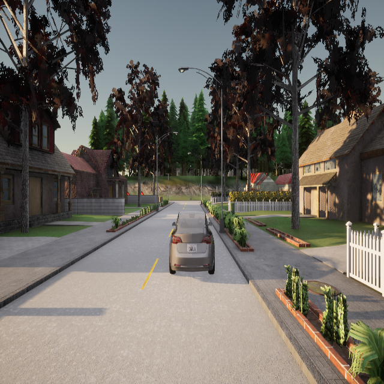

图中为归档源图020949.png，车距约9.75 m。它与后面灰度示例来自同一个原始图像ID。完整RGB链路保留图中的颜色信息；后面的32×32图是专门为消融生成的灰度输入。

### 1.2 固定我的控制器，仅切换前端的组件实验

**本节两边都使用我的鲁棒控制器和我的屏障。** 仅切换图像到距离的估计器。原发布头从图像域直接迁移，我的RGB前端经过目标域训练；共用同一24k部署图库、动力学和配对初态。各采199条校准轨迹、另测500条轨迹。

| 本节分支 | 视觉输入与估计 | 实际控制器 | 实际验证屏障 |
|---|---|---|---|
| 我的RGB前端分支 | RGB→DINO→距离读出 | 我的鲁棒控制器 | 我的鲁棒屏障 |
| 原灰度头交叉分支 | 原灰度处理→原发布距离估计器 | 同一份我的鲁棒控制器 | 同一份我的鲁棒屏障 |

本节固定后端比较前端；原SPVC配套控制器的整链路结果见第8节。

| 指标             | 我的RGB DINO前端 | 原灰度头＋我的控制器 |
| -------------- | -----------: | -------------: |
| 相对真实距离的整轨CP半宽  |     0.4096 m |       8.0584 m |
| 500条中全程在各自误差界内 |      483/500 |        487/500 |
| 目标完成           |      500/500 |          0/500 |
| 危险终止           |        0/500 |        500/500 |

本节为既有RGB检查点的CLS读出，使用全24k部署图库；后文灰度空间读出使用3229张留出图库，对应另一组结构和评估设置。颜色本身的贡献应通过相同读出、相同图库的RGB／灰度消融计算。

这是已有检查点在目标图库上的部署适配比较。图库含RGB前端训练和开发时使用的图片，独立抽样单位为新的完整轨迹。

另固定证书允许误差±0.45 m，配对测试2000条新轨迹，我的RGB前端有1985/2000条全程满足该误差前提、2000/2000条完成任务；原发布头为0/2000条在界内、0/2000条完成。原头直接迁移与RGB目标域适配分别列明；灰度受控消融在后文保留。

[RGB部署对照原始结果](../../artical-F122/results/aebs_native_cross_20261117_v1/full_release_bank/report.json) · [固定证书半径测试](../../artical-F122/results/aebs_native_cross_20261117_v1/fixed_tube_2000/report.json)

#### 图1．固定我的后端切换前端，怎样读？

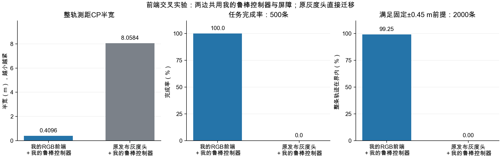

- **左图看误差预算**。纵轴为测距CP半宽，单位米，越低越紧；我的RGB前端约0.410 m，原发布头直接迁移约8.058 m。
- **中图看任务完成**。纵轴为百分比，在500条新轨迹中，两者分别完成500和0条。
- **右图看固定证书前提**。阈值固定为±0.45 m，在另一批2000条中，我的RGB前端有1985条全程满足，比例99.25%，原发布头为0条。这个比例与中图的任务完成率各自统计。
- **比较条件**。两边共用我的控制器和屏障，比较的是前端交叉组合。RGB模型经过目标域适配，原头直接迁移。右图中另外15条RGB轨迹超出误差前提，实测仍完成任务。

### 1.3 后续表格分别对应哪些组件？

| 比较部分   | 我这一侧实际使用什么？      | 与谁比较？                | 共用什么条件？                  |
| ------ | ---------------- | -------------------- | ------------------------ |
| 视觉前端   | DINO空间读出，灰度输入消融  | SPVC结构像素MLP，目标域重训    | 同源图片、标签、灰度源输入、数据划分和选型机会  |
| 控制器    | 我的鲁棒控制器，搭配原MLP   | SPVC发布PPO，搭配同一原MLP   | 视觉函数、起步条件、车辆模型、动作范围、任务判据 |
| 车道反馈   | 我的二维状态估计＋解析反馈适配组 | SPVT发布PID初始化、历史第100轮 | 原生成器、动力学、初态与随机扰动流        |
| 训练目标消融 | 上述低维反馈组          | 原端到端结构按同一精度目标监督重训    | 训练样本、更新预算、参考动作目标         |

**下面AEBS前端数值属于灰度消融。我的完整视觉方案保留RGB输入。** SPVT适配实验使用其128维生成观测，表中标清对应版本。

## 2. 灰度受控消融的数据用途：原图训练，变换图评估

| 阶段      | 使用什么数据？                | 用来做什么？          |
| ------- | ---------------------- | --------------- |
| 训练      | 14172张原始版本图片，转为32×32灰度 | 更新网络参数          |
| 开发选型    | 4908张原始版本图片            | 选择学习率、结构候选和训练轮次 |
| 冻结后静态评估 | 3229张留出原图，分别生成七种输入版本   | 比较同一图片的预测误差     |
| CP校准    | 每种条件499条完整轨迹           | 用全程最大误差确定该模型的q  |
| 闭环测试    | 每种条件另有2000条测试轨迹        | 统计覆盖率、任务完成和危险   |

24k表示原图总包量。图库原有的天气和光照变化保留，人工变暗、变亮、模糊图用于冻结模型之后的评估和对应条件的CP校准。校准与测试按轨迹分开抽初态，共用固定留出图库。

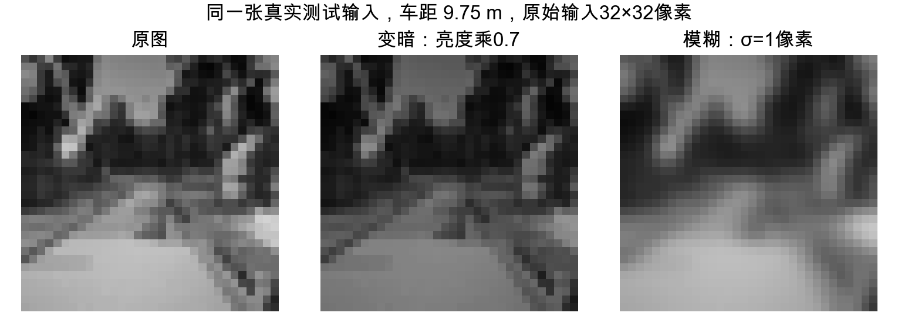

原图车距9.75 m。亮度×0.7保留70%的灰度数值；模糊σ=1的单位为32×32原始输入的像素。

## 3. 辅助消融：我的前端与SPVC结构在相同灰度输入下比较

**本节数值全部来自灰度受控消融。怎么比？** 同一批3229张留出图片，两个前端均读取相同灰度源图；模型按原图训练、开发选型后冻结。表中取三个训练种子均值。

### 3.1 测距准不准？

指标是静态MAE，表示预测车距偏离真实距离的平均绝对值，单位cm，越小越好。

| 图像条件 | 我的DINO前端，灰度消融（cm） | SPVC结构MLP（cm） |
| --- | --- | --- |
| 原始画面 | 10.07 | 2.60 |
| 亮度×0.7 | 11.26 | 101.34 |
| 亮度×1.3 | 20.58 | 24.89 |
| 对比度×0.7 | 11.44 | 2.69 |
| 对比度×1.3 | 55.98 | 5.18 |
| 模糊0.5 | 22.31 | 15.07 |
| 模糊1.0 | 276.30 | 61.62 |

**结果含义。** 变暗时，我的前端平均误差从对照的101.34 cm降到11.26 cm，减少88.9%。正常画面、对比度变化和模糊条件的结果也完整列出，原MLP在多项条件中更准。

### 3.2 相同覆盖目标，需要多大的测距CP范围？

两前端接同一份鲁棒控制器，采用相同初态和外观抽样，分别运行自己的闭环。各自用499条校准轨迹确定q，再用2000条测试轨迹检查。q为整轨测距误差半宽，单位m，越小表示所需误差预算越少；覆盖率要求整趟全部时刻都在界内。

| 图像条件 | 我的q（m） | SPVC结构q（m） | 我的整轨覆盖 | SPVC结构整轨覆盖 |
| --- | --- | --- | --- | --- |
| 原始画面 | 1.043 | 0.888 | 94.87% | 94.80% |
| 亮度×0.7 | 1.043 | 3.354 | 94.95% | 94.62% |
| 亮度×1.3 | 2.154 | 1.416 | 93.78% | 96.63% |
| 对比度×0.7 | 1.097 | 0.895 | 94.88% | 95.80% |
| 对比度×1.3 | 2.290 | 0.973 | 96.85% | 96.18% |
| 模糊0.5 | 1.419 | 1.038 | 95.77% | 94.25% |
| 模糊1.0 | 7.859 | 2.465 | 94.50% | 96.00% |

**结果含义。** 亮度×0.7时，误差包络从±3.354 m缩至±1.043 m，半宽减少68.9%，两者新测试整轨覆盖率均约95%。清晰画面中，原MLP的q更小。

#### 图2．七条件的前端误差与CP范围

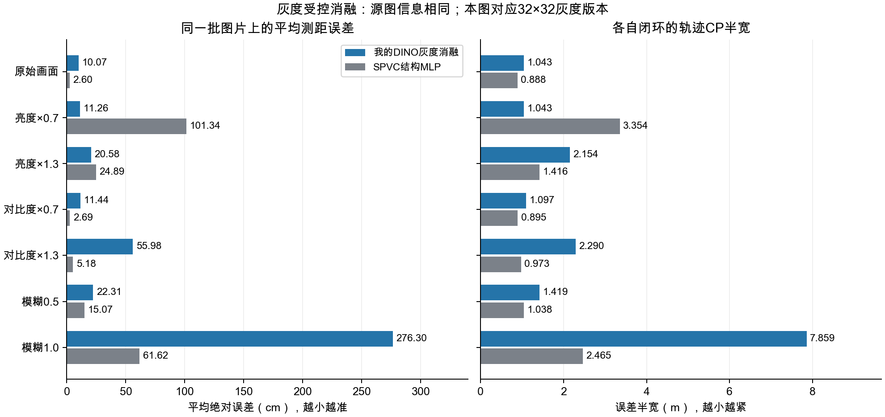

**读图方法。** 每行是一种输入条件，蓝色为我的DINO灰度消融，灰色为SPVC结构MLP。左图横轴为平均绝对测距误差，单位cm；右图为轨迹CP半宽，单位m，两图均是条越短，所需误差越小。

**看出的结果。** 亮度×0.7这一行，蓝色的平均误差和CP半宽都明显更小。原始画面和强模糊等行则是灰色更短。因此这张图显示完整条件中的效果差异。图中两边共用灰度源输入，右图q分别来自各自闭环轨迹；RGB前端组件交叉结果见图1。

### 3.3 接同一控制器后，前端差异会怎样影响任务？

任务要求进入5–6 m时速度≤0.5 m/s。两边都使用我的鲁棒控制器，只改变前端；起步距离15–16 m、速度2.5–3 m/s，表中为每组2000条的完成率。

| 图像条件 | 我的DINO前端＋鲁棒控制器 | SPVC结构MLP＋同一控制器 |
| --- | --- | --- |
| 原始画面 | 100.00% | 100.00% |
| 亮度×0.7 | 100.00% | 100.00% |
| 亮度×1.3 | 100.00% | 100.00% |
| 对比度×0.7 | 100.00% | 100.00% |
| 对比度×1.3 | 89.07% | 100.00% |
| 模糊0.5 | 96.92% | 100.00% |
| 模糊1.0 | 13.33% | 100.00% |

**这一组的结论。** 已测到的前端优势集中在指定变暗条件，其他条件各有实际表现。RGB完整版本应按其自身数据评价。

## 4. 我的控制器与SPVC发布PPO比较

**怎么比？** 两边共用同一份原SPVC结构MLP前端，分别接我的鲁棒控制器与发布PPO。共用车辆模型、初态抽样、图像条件和任务判据；不同动作会形成不同后续轨迹。

### 4.1 七种条件下的完成率

每种条件、每个前端种子分别运行2000条，表中是三个种子的平均完成率。

| 图像条件 | 我的鲁棒控制器 | SPVC发布PPO |
| --- | --- | --- |
| 原始画面 | 100.00% | 100.00% |
| 亮度×0.7 | 100.00% | 100.00% |
| 亮度×1.3 | 100.00% | 91.93% |
| 对比度×0.7 | 100.00% | 100.00% |
| 对比度×1.3 | 100.00% | 100.00% |
| 模糊0.5 | 100.00% | 91.78% |
| 模糊1.0 | 100.00% | 0.55% |

#### 图3．固定视觉前端后，控制器能完成多少任务？

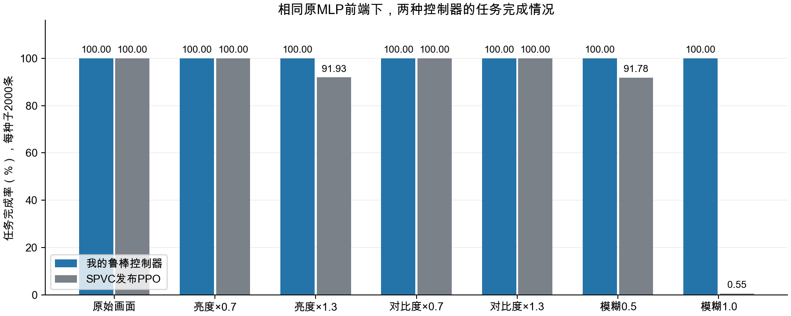

**读图方法。** 横轴为图像条件，纵轴为任务完成率。蓝色是我的鲁棒控制器，灰色是SPVC发布PPO；两边共用同一套原MLP前端，每种子2000条，柱高取三个种子均值。

**看出的结果。** 强模糊1.0下，灰色约0.55%，蓝色100%，表示当前控制器在这组误差读数下能完成更多任务。其他条件的柱也完整保留。图中固定视觉函数，差别来自两个已有控制器；训练预算与训练过程按第1节解释。

### 4.2 强模糊下，逐种子的完成与危险计数

每格分母为2000条。危险指接近目标距离时车速仍超过0.5 m/s。

| 前端种子 | 我的完成 | PPO完成 | 我的危险 | PPO危险 |
| --- | --- | --- | --- | --- |
| 27411 | 2000/2000 | 33/2000 | 0/2000 | 1967/2000 |
| 27412 | 2000/2000 | 0/2000 | 0/2000 | 2000/2000 |
| 27413 | 2000/2000 | 0/2000 | 0/2000 | 2000/2000 |

平均完成率由0.55%提高到100%，增加99.45个百分点；配对场景重采样的95%区间为[99.25,99.63]个百分点。这项结果对应两个已训练控制器，它们训练过程和预算不同。

### 4.3 正常画面：六种起步条件是否都能完成？

每格使用1000条新测试，前端仍固定为同一原MLP。时间取成功时的实际达标时间，失败统一计20 s。

| 起步距离 / 初速 | 我的完成率 | PPO完成率 | 我的时间（s） | PPO时间（s） |
| --- | --- | --- | --- | --- |
| 10–12 m / 1–2 m/s | 100.0% | 100.0% | 8.32 | 3.91 |
| 10–12 m / 2–3 m/s | 100.0% | 100.0% | 7.83 | 3.32 |
| 12–14 m / 1–2 m/s | 100.0% | 100.0% | 9.04 | 4.03 |
| 12–14 m / 2–3 m/s | 100.0% | 100.0% | 8.73 | 3.75 |
| 14–16 m / 1–2 m/s | 100.0% | 100.0% | 9.53 | 4.51 |
| 14–16 m / 2–3 m/s | 100.0% | 100.0% | 9.31 | 4.38 |

**这一组的结论。** 正常画面中两者完成率持平、PPO更快；误差较大的指定条件下，我的控制器能完成更多任务。时间和误差承受能力需要一起看。

#### 图4．正常条件下，完成率相同时谁更快？

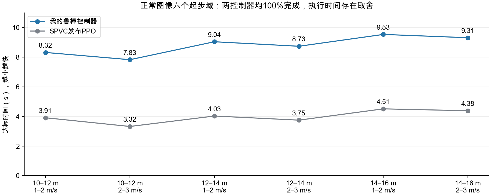

**读图方法。** 横轴每个点是一组起步距离和车速，纵轴是达标时间，单位秒，越低越快。这六组中两控制器均100%完成任务。

**看出的结果。** 我的控制器蓝线在7.8–9.5 s，PPO灰线在3.3–4.5 s。结合图3可见，当前控制器在指定误差条件下更能完成任务，同时在正常条件中付出更长执行时间。两项指标共同体现控制器的取舍。

## 5. 我的低维反馈适配组与SPVT比较

**怎么比？** 同一SPVT生成器、动力学、2000个初态和扰动流。车速5 m/s，每步0.05 s，每趟8 s；初始横偏±60 cm、航向±7°，安全条件为全程横偏≤80 cm。

我的适配组使用 **128维生成观测 → 二维状态估计 → 解析反馈**。另设原网络结构按同一精度目标监督重训的辅助组，以检查目标训练的作用。

### 5.1 每步随机扰动：整体精度、达标与速度

| 比较对象 | RMSE（cm） | 持续±5 cm | 持续±20 cm | 稳定进入时间（s） |
| --- | --- | --- | --- | --- |
| 我的低维反馈适配组 | 7.53 | 2000/2000 | 2000/2000 | 1.126 |
| SPVT发布PID初始化 | 13.81 | 308/2000 | 1199/2000 | 4.911 |
| SPVT历史第100轮 | 21.52 | 0/2000 | 377/2000 | 8.000 |
| 原结构同目标监督重训 | 7.51 | 2000/2000 | 2000/2000 | 1.185 |

RMSE先对每趟横偏平方平均后开方，再对场景平均，越小越准。持续达标要求第2–8秒的所有时刻均在对应范围内。稳定进入时间是首次进入±5 cm并保持到结束的时刻，未达到计8 s。四组在这批测试中危险计数均为0/2000。

#### 图5．车道精度、达标率和恢复速度分别看什么？

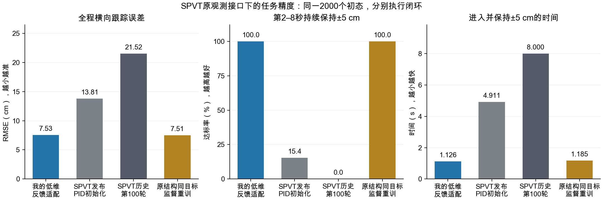

- **左图看整趟误差**。纵轴RMSE单位cm，越小越准；我的适配组7.53 cm，PID初始化13.81 cm，历史第100轮21.52 cm。
- **中图看严格目标**。纵轴为第2–8秒持续留在±5 cm内的比例；我的组和同目标端到端重训组都为100%。
- **右图看恢复速度**。纵轴是进入并保持±5 cm的时间；我的组约1.126 s，同目标组约1.185 s，PID初始化约4.911 s，未达到目标记8 s。
- **比较含义**。蓝色表示我的二维反馈适配，金色表示原结构同目标监督重训。两组都获得主要精度提升，图中同时展示了目标训练和结构适配的作用。本组使用SPVT原生成观测接口。

### 5.2 精度要求从±40 cm收紧到±5 cm，会怎样？

以下复用同一批2000条轨迹，显示从第2秒到第8秒持续满足目标的比例。

| 要求范围 | 我的适配组 | SPVT发布PID | SPVT第100轮 | 同目标端到端 |
| --- | --- | --- | --- | --- |
| ±40 cm | 100.00% | 100.00% | 99.50% | 100.00% |
| ±20 cm | 100.00% | 59.95% | 18.85% | 100.00% |
| ±10 cm | 100.00% | 31.30% | 0.00% | 100.00% |
| ±5 cm | 100.00% | 15.40% | 0.00% | 100.00% |

**结果含义。** 精度要求收紧后，已有SPVT检查点的达标比例下降；两个按新精度目标训练的组仍100%达标。精度目标训练贡献了主要改善。

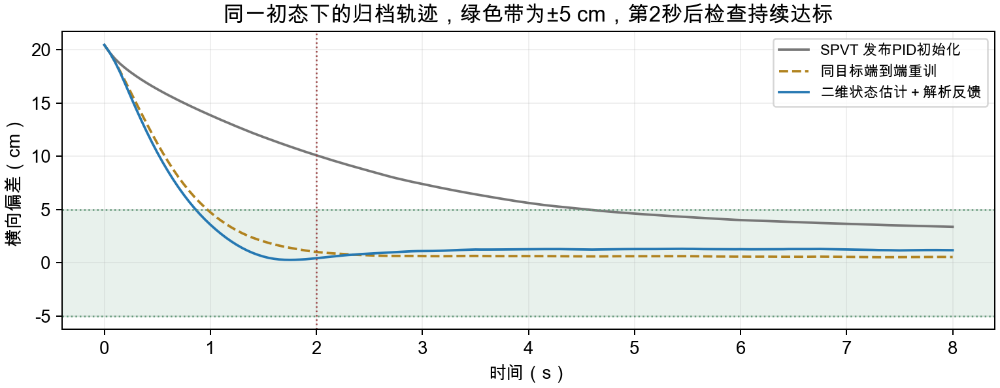

这条示例初始横偏20.47 cm、航向−1.63°，取归档场景第0条。绿色带为±5 cm，竖线为第2秒。表格指标来自全部场景，曲线帮助理解指标。

### 5.3 一趟保持同一个扰动，结果是否仍成立？

同一套2000个初态，每条轨迹的随机z保持固定，检查持续性偏差。

| 比较对象 | RMSE（cm） | 持续±5 cm | 持续±20 cm | 稳定进入时间（s） |
| --- | --- | --- | --- | --- |
| 我的低维反馈适配组 | 7.54 | 2000/2000 | 2000/2000 | 1.126 |
| SPVT发布PID初始化 | 13.81 | 307/2000 | 1196/2000 | 4.914 |
| SPVT历史第100轮 | 21.50 | 0/2000 | 361/2000 | 8.000 |
| 原结构同目标监督重训 | 7.51 | 2000/2000 | 2000/2000 | 1.185 |

我的组和同目标端到端组在两种扰动方式下均100%持续保持±5 cm。我的组平均进入时间快约0.06 s，同目标端到端组的全程RMSE略低。

### 5.4 改变初始横偏和航向：九个范围全部列出

模型先冻结，每个范围另有499条校准和1000条测试。下表为持续±5 cm达标率，各域使用配对抽样。

| 初始横偏 / 航向 | 我的适配组 | SPVT发布PID | SPVT第100轮 | 同目标端到端 |
| --- | --- | --- | --- | --- |
| ±20 cm / ±2° | 100.0% | 44.9% | 0.0% | 100.0% |
| ±20 cm / ±4° | 100.0% | 45.1% | 0.0% | 100.0% |
| ±20 cm / ±7° | 100.0% | 44.5% | 0.0% | 100.0% |
| ±40 cm / ±2° | 100.0% | 23.2% | 0.0% | 100.0% |
| ±40 cm / ±4° | 100.0% | 22.8% | 0.0% | 100.0% |
| ±40 cm / ±7° | 100.0% | 23.2% | 0.0% | 100.0% |
| ±60 cm / ±2° | 100.0% | 14.8% | 0.0% | 100.0% |
| ±60 cm / ±4° | 100.0% | 15.0% | 0.0% | 100.0% |
| ±60 cm / ±7° | 100.0% | 14.6% | 0.0% | 100.0% |

最宽域的新1000条场景中，我的RMSE为7.65 cm，PID初始化为14.04 cm；稳定进入时间分别为1.12和4.96 s。九域都在状态回归训练范围±75 cm、±10°内部，体现训练域内不同初态的恢复能力。

#### 图6．九个初态域的结果，一眼怎样看？

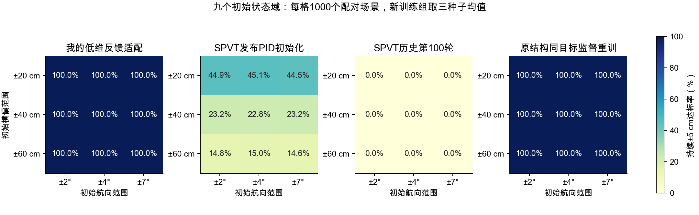

**读图方法。** 四个面板分别对应四种模型。每个小格是一组初始横偏和航向范围，每格1000条配对测试轨迹。所有面板共用0–100%色标，颜色越深表示持续±5 cm达标率越高，格中的文字是实际比例。

**看出的结果。** 我的适配组和同目标重训组九格均100%；PID初始化随初始横偏范围扩大，严格达标率降低。这些初态域都在状态回归的训练范围内，图中体现不同训练域内起步偏差的恢复能力。学习模型的格值为三个固定训练种子均值。

## 6. SPVT场景的动作统计包络：保留数据，讲清对象

这里统计每趟实际转角与新参考反馈律的最大偏差，用499条轨迹校准q、2000条新轨迹检查覆盖。单位为度。

**本表用于参考策略模仿诊断。** 当前训练使用该参考律，旧检查点学习其它目标；因此数值包含策略目标差异。

| 模型 | 每步随机q（°） | 每步随机覆盖 | 整轨固定q（°） | 整轨固定覆盖 |
| --- | --- | --- | --- | --- |
| 我的低维反馈适配组 | 3.348 | 95.03% | 3.376 | 95.18% |
| SPVT发布PID初始化 | 15.234 | 94.20% | 15.218 | 94.05% |
| SPVT历史第100轮 | 18.822 | 94.95% | 18.822 | 94.95% |
| 原结构同目标监督重训 | 1.075 | 94.47% | 1.078 | 95.33% |

对同一批10000个状态的补算发现，旧PID相对新参考律的名义偏差约7.33°，改变观测随机变量引起的平均动作变化约0.067°。原表中15.23°与3.35°的差异主要受策略目标影响。此表保留为行为诊断，前端误差结论采用实际观测与代理之间的残差。

## 7. 验证能力：相同误差支持下的五任务结果

这组来自此前共同接口实验，固定控制器、动力学和允许误差，比较我的屏障验证与SPVT式多步可达组件。三百秒预算用于该多步可达实现；这里比较验证机制。

| 任务 | 登记时域 | 我的检查结果与时间 | SPVT式多步可达结果 |
| --- | --- | --- | --- |
| AEBS | 400步 | 通过，115.77 s | 完整时域未决 |
| 车道保持 | 80步 | 通过，9.44 s | 完整时域未决 |
| 五维制动 | 14步 | 通过，0.017909 s | 2000/2000个测试初态完成 |
| 六维悬停 | 24步 | 通过，0.000327 s | 2000/2000个测试初态完成 |
| 八维起重机 | 40步 | 通过，0.142447 s | 2000/2000个测试初态完成 |

AEBS和车道长时域中，我的屏障完成了登记区域检查，多步可达组件在本次预算内保留未决结果；另外三个任务两种机制均完成各自检查。AEBS、车道及五维为数值检查，悬停和起重机使用有理数充分条件／支持界。原生SPVT的完整训练与这一共同接口组件的结果分别解释。

## 8. 新增：原SPVC用自己的控制器，我方用自己的控制器

原SPVC组使用原交替综合得到的控制器及配套SBC；我方使用RGB DINO及鲁棒控制器。256个状态的动作一致性检查差值为0，三套原SPVC模型均保持原实现。

同一离散车辆模型、15–16 m初距、2.5–3 m/s初速和12种外观。每臂499条校准、2000条新测试轨迹；成功为d∈[5,6] m且v≤0.5 m/s，危险为d≤6 m且v>0.5 m/s。两个图库分开报告。

| 整链路 | 留出3229张：完成／2000 | 固定24k张：完成／2000 |
|---|---:|---:|
| 原SPVC自己的前端＋自己的综合控制器，种子171 | 0 | 0 |
| 同上，种子172 | 0 | 0 |
| 同上，种子173 | 0 | 0 |
| 我的RGB DINO＋我的鲁棒控制器 | **2000** | **2000** |

这三套原SPVC系统在本次相机回放中均触发共同危险条件。我方完成全部任务。原前端沿用原400张H5训练来源，我方使用24k目标域RGB及DINO预训练；该组按各自训练历史评价目标相机环境中的部署表现。

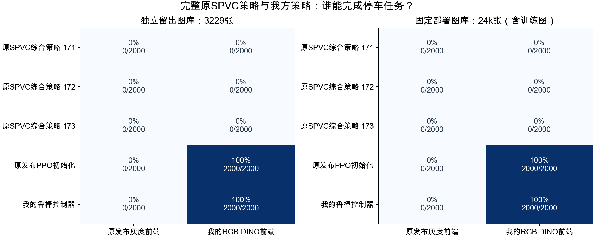

**图的意思。** 行固定控制器，列切换前端。原发布PPO接我的DINO也达到2000/2000，说明前端迁移贡献明显；三个原综合控制器换DINO后仍未完成，说明控制器还影响结果。DINO＋发布PPO与我的完整链路均完成全部任务，时间和终端速度见下图。

| 我的RGB完整链路 | 留出图库 | 固定24k部署图库（含训练图） |
|---|---:|---:|
| 新CP半宽 | **1.219 m** | **0.396 m** |
| 原±0.45 m证书前提全程成立 | **0/2000** | **1988/2000** |
| 我方原屏障能否覆盖新q？ | **未通过：存在正漂移** | **可以，误差集合包含检查通过** |

**CP差异的来源。** 留出图库的最大图片距离失配约0.898 m，固定24k图库约0.003 m。图库密度影响闭环观测误差，留出环境需要按1.219 m误差支持重新综合。

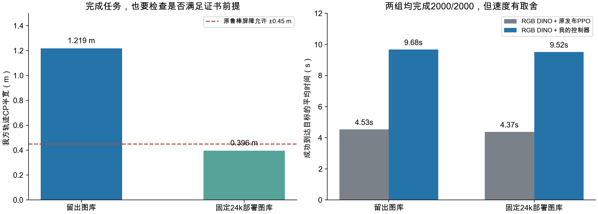

**左图**检查是否满足原±0.45 m支持。**右图**固定RGB DINO后比较时间：留出图库原发布PPO平均4.529 s，我方9.683 s；我方进入目标的平均速度更低，为0.124 m/s，原PPO为0.348 m/s，二者都满足任务速度要求。

**证书范围。** 固定24k环境通过误差集合包含检查，适用登记的回放律、终止式离散模型及轨迹CP条件，后端采用数值区间验证。留出图库记录2000/2000条任务成功，其1.219 m误差支持的屏障检查未通过。

原SPVT的原任务测试、RGB部署和共同视觉策略比较见第9节。

[本轮详细设置、全部结果与接入检查](../experiments/跨实验对照/原实现整链路对照与我方接入复核_20261123.md)

## 9. 新增：我方RGB框架与原SPVT实际对照

原SPVT采用已有100轮历史训练模型。从26个检查点中，在256个独立开发场景按安全率、横偏RMSE选出第55轮，再冻结。原生成观测下2000条新轨迹全部保持80 cm安全约束；第55轮RMSE为15.74 cm，第100轮为21.69 cm，发布初始化为13.97 cm。

### 9.1 同一新RGB道路环境，完整权重如何表现？

使用原SPVT车辆动力学：5 m/s、0.05 s步长、2.5 m轴距，初始横偏±60 cm、航向±7°，8秒160步。每步按各控制器的当前状态渲染新的RGB图像。每臂199条校准，冻结所有阈值后测1000条新轨迹。

| 整链路 | 全程横偏≤80 cm | 第2–8秒持续±5 cm |
|---|---:|---:|
| 原SPVT第55轮，原灰度输入和原控制网络 | 0/1000 | 0/1000 |
| 我的RGB DINO＋我的神经控制器 | **1000/1000** | **1000/1000** |

原模型在原生成观测下安全，在该目标RGB图像域直接迁移失败；我方前端已针对该合成道路训练。比较条件：原SPVT使用历史训练权重，我方使用目标道路训练的RGB前端与既有控制器；输入分辨率和训练预算按各自来源保留。图像由合成道路逐状态渲染。

### 9.2 共用同一DINO视觉观测，控制精度有多少收益？

共同DINO的原策略分支执行“DINO观测→状态单位换算→原G(0,x̂)→原控制器”，保留原网络及权重。该组固定视觉函数，直接比较控制策略。

| 共同RGB DINO下的策略 | 全程安全／1000 | 持续±5 cm／1000 | 横偏RMSE | 稳定进入±5 cm时间 |
|---|---:|---:|---:|---:|
| 原SPVT第55轮名义策略 | 1000 | 0 | 16.092 cm | 7.748 s |
| 原发布初始化名义策略 | 1000 | 123 | 15.202 cm | 5.735 s |
| 我的神经控制器 | **1000** | **1000** | **6.439 cm** | **0.781 s** |

**直观收益：** 对比原SPVT选定策略，我方RMSE下降约**60%**，持续±5 cm从0/1000提高到1000/1000。未稳定进入的轨迹按8 s计，因此时间差也包含是否达标的差异。控制器训练来源：原策略保留原训练目标，我方采用既有精度与鲁棒微调。

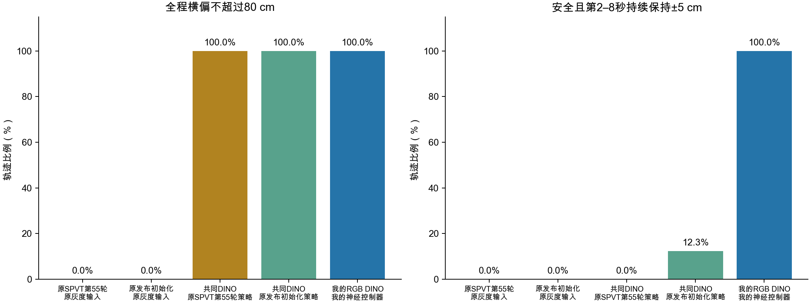

**读图：** 左边看是否安全，右边看是否精确。共同DINO的三组都安全，但我方实现了全部严格精度目标。代价是动作更活跃：每步转向平均变化为0.843°，原SPVT策略0.491°，原初始化策略0.714°。

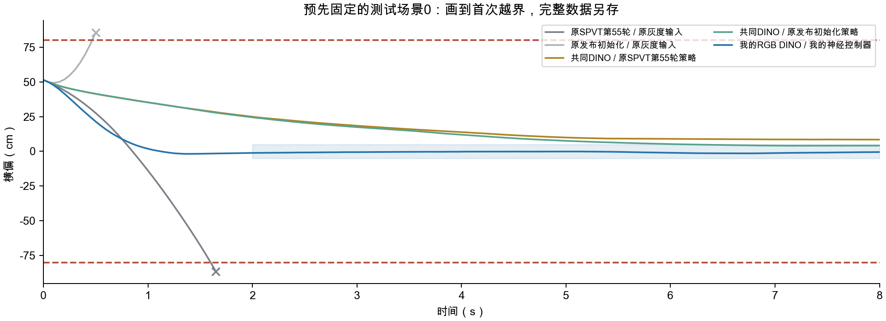

**读图：** 浅蓝区域是第2秒开始的±5 cm目标。原输入迁移组画到首次越界并标×；共同DINO的策略轨迹继续画到8秒。曲线对应预定的第0条测试场景。

### 9.3 CP更小，具体小的是哪种误差？

| 共同DINO下的比较 | 原SPVT第55轮策略 | 我的策略 | 改善 |
|---|---:|---:|---:|
| 实际图像动作－自身代理动作的整轨CP半宽 | 3.791° | **3.061°** | 缩小19.25% |
| 全程安全＋第2–8秒尾部横偏的任务CP半宽 | 35.225 cm | **1.704 cm** | 缩小95.16% |

动作CP比较实际图像动作与自身名义动作，单位为度；任务CP描述安全轨迹的尾部横偏，单位为cm。各策略按自己的闭环轨迹分别校准，原SPVT行采用同样的事后评价流程。

**连接我方前后端的视觉CP集合**为归一化q=0.083471656，即整轨同时允许横偏观测误差±7.095 cm、航向观测误差±1.435°；新测试970/1000条全程落在集合内。

还在1000个完全相同初态的第一帧上，使用原G的完整10维潜变量集合和原网络backward界传播检查代理动作范围：第55轮原模型仅561/1000个真实图像动作在该范围内。该动作区间包含率量化了目标相机域中实际观测与生成代理的适配差距。

### 9.4 新任务的神经鲁棒屏障也重新求解了

控制器和RGB前端冻结后，只训练我方2→16 Tanh→8 Tanh→1 ReLU屏障。新5 m/s任务及当前CP误差集合的数值区间检查通过：

| 条件 | 实际结果 |
|---|---:|
| 初始集屏障上界≤1 | **0** |
| 危险集屏障下界≥20 | **24.523844** |
| 鲁棒不增检查的未决单元／实际反例 | **0／0** |

**安全保证。** 神经屏障验证集合内全部允许误差下的鲁棒不增，给出离散模型在误差事件上的条件安全；视觉CP为规定160步、同一相机抽样律提供边际覆盖。后端采用float64数值区间检查。视觉CP与任务精度CP的指标和概率分别报告。

[详细报告、逐层网络结构、实际观测图和全部数据](../experiments/跨实验对照/SPVT与当前RGB框架_原实现对照与误差校准_20261123.md)

## 10. 汇报结论：我的框架已有哪几类证据？

| 观察到的效果 | 它对应的组件 |
|---|---|
| RGB前端在固定我方后端的交叉实验中满足误差前提并完成任务 | 目标域适配前端与我方后端的组合，第1.2节 |
| 变暗条件下测距更准，测距CP更紧 | 我的DINO灰度输入消融 |
| 固定原MLP反馈时，误差条件下完成更多AEBS任务 | 我的已训练鲁棒控制器 |
| 精度目标训练后，车道跟踪明显改善 | 低维反馈适配与同目标端到端两组 |
| 低维适配组比同目标组平均快约0.06 s进入目标范围 | 观测结构、状态监督与反馈设计的联合效果 |
| AEBS和车道长时域的数值检查完成 | 当前屏障验证组件 |
| 原SPVT物理任务中，共同RGB DINO下RMSE下降60%、严格±5 cm全部达标 | 新增原训练策略交叉，第9节；我方神经控制器 |
| 原SPVT物理任务的当前CP集合得到新神经屏障数值通过 | 冻结RGB前端与控制器后的我方新证书，第9.4节 |

我的完整前端方案使用RGB，输入示例见第1.1节。第8节补齐原SPVC配套控制器部署结果，第9节补齐原SPVT训练模型的原任务与RGB部署比较，以及共同视觉策略交叉和新屏障。前端收益看观测误差与代理包络，控制收益看精度与响应时间，安全接口收益看对应误差集合下的证书范围。

## 11. 数据来源和读表约定

第2–7节的三种子均值按冻结模型汇总，每个模型使用自己的校准q，统计单位为完整轨迹。第8节三套原SPVC综合模型单列。第9节采用原SPVT历史训练与我方预定首种子，每臂1000条新的共同RGB测试，原生成任务另有2000条；五组共用配对场景，各组分别计数。

- [AEBS七条件完整数据](../../artical-F122/results/benefit_cp_aebs_20261122/aggregate.json) · [AEBS六起步域](../../artical-F122/results/general_aebs_precision_20261123/aggregate.json)。
- [SPVT两种扰动完整数据](../../artical-F122/results/benefit_native_spvt_20261122/aggregate.json) · [九个初态域](../../artical-F122/results/general_spvt_precision_20261123/aggregate.json)。
- [五任务验证数据](../../artical-F122/results/paper_backend_comparison_20261118_v1/summary.json)。
- [详细实验设置](../experiments/跨实验对照/当前方法相对SPVC与SPVT_正常任务精度与CP收益实测_20261123.md) · [实验设计复核](../experiments/跨实验对照/SPVC_SPVT统一对照_实验设计复核_20261123.md)。

新增六张图均由归档JSON结果生成，数值、源文件哈希及绘图脚本绑定见[图表数据清单](../assets/general_benefits_20261123/comparison_charts_manifest.json)。
