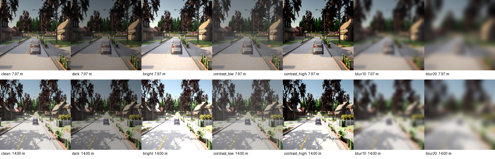
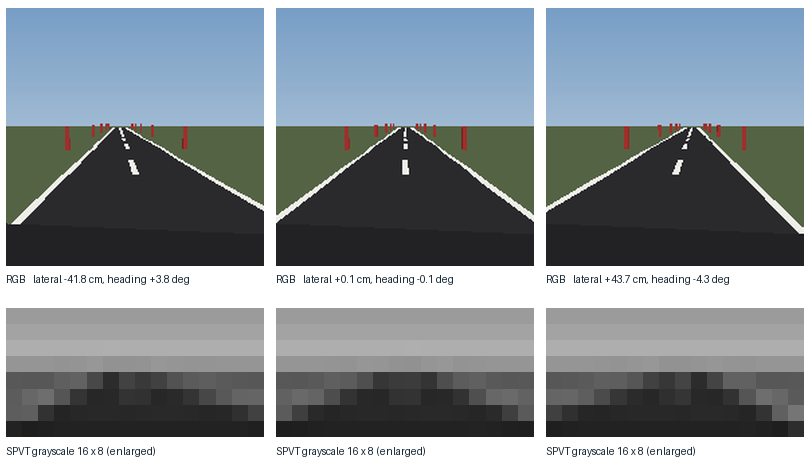
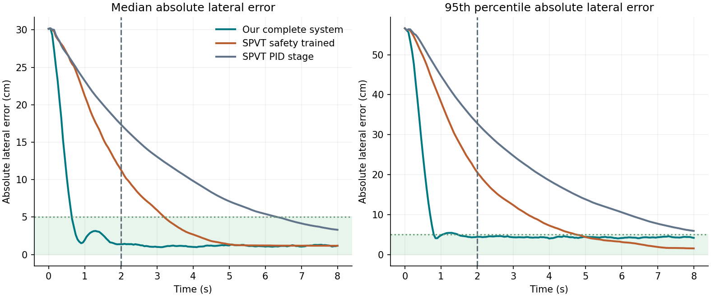

# 我的框架与 SPVC、SPVT 比较｜图文汇报

2026 年 11 月 25 日

| 整链路对照 | 最直观的结果 | 需要一起看的指标 |
|---|---|---|
| **AEBS 紧急制动｜我方 vs SPVC** | 原图上，我方完成 **2,000/2,000** 条，SPVC 完成 **674/2,000** 条 | 两档模糊下，SPVC 都完成更多 |
| **车道保持｜我方 vs SPVT** | 全程横偏 RMSE 从 **11.32 cm 降到 6.38 cm**，第 2–8 秒持续 ±5 cm 的轨迹从 **122 增到 393 条** | 两边 500 条都安全。我方早段纠偏更快，SPVT 转向更平顺、末段偏差更小 |

每个任务都用同一批 RGB 源图和状态标签分别复训两套系统，测试时各用自己的前端和控制器。我方 DINO 保留 RGB 三通道，对照方法沿用各自的灰度输入。测试配对的是初态和环境设置，动作不同后，两套系统各自演化。

## 1. AEBS 紧急制动｜我方 vs SPVC

### 1.1 车辆要做什么，图用在哪？

车辆从车距 15–16 m、车速 2.5–3 m/s 起步，每 0.05 s 更新一次。**完成**要求进入 5–6 m 时车速不超过 0.5 m/s。**危险**指车距降到 6 m 及以内时，车速仍超过 0.5 m/s。回放时，环境按当前车距和外观选取留出图库中车距最接近的照片，控制器读取该照片的测距和当前车速。

| 扩展 CARLA RGB 图包 | 张数 | 用途 |
|---|---:|---|
| 训练图 | 14,388 | 两边使用相同图片和车距标签训练视觉模型 |
| 开发图 | 2,400 | 我方选择视觉投影，并确定鲁棒训练用的误差范围 |
| 留出图 | 7,212 | 测静态测距，供校准和测试轨迹回放 |

亮度、对比度和高斯模糊都在模型冻结后施加于留出 **RGB 源图**，再分别送进两边的前端。每种条件各有 499 条校准轨迹和 2,000 条测试轨迹，初态和外观逐条配对。

两行车距约为 7.97 m 和 14.00 m。从左到右是原图、变暗、变亮、低对比、高对比、较轻模糊、较强模糊。模糊参数 $\sigma$ 以 640×640 源图的像素为单位。

### 1.2 两套系统怎样训练？

两边先用本轮新训的同一个 PPO 作起点。PPO 在标称车辆模型上读取归一化距离和车速，学习约 20 万个交互步。奖励包含接近目标的进度、耗时，以及进入目标附近时的低速奖励或超速惩罚。选检查点时，模拟评估回合上限为 400 步。

| 环节 | 我方完整框架 | SPVC 完整复训 |
|---|---|---|
| 视觉模型 | 冻结 RGB DINOv2-S/14，用训练图拟合 384→128→128→1 的距离投影。状态代理输出归一化真距离 | 用同一图包训练 32×32 灰度生成器，再用生成图训练 1024→256→64→1 测距头 |
| 控制器综合 | 用开发数据确定视觉误差范围，对范围内最不利的后继计算屏障损失，微调 PPO，并在训练图回放中检查任务表现 | 用新生成器、测距头和 PPO 按原程序交替更新控制器与随机屏障，使用原随机转移模型 |
| 上线输入 | RGB DINO 的测距和车速 | 灰度测距头的输出和车速 |

结果里另列 **SPVC 新 PPO 阶段**。这一行使用 SPVC 自己的测距头和刚训练好的 PPO，展示交替综合前的表现。

### 1.3 测距和制动结果

| 图像条件 | 我方测距 MAE（cm） | SPVC 测距 MAE（cm） | 我方完成 / 危险 | SPVC 完整复训完成 / 危险 | SPVC 新 PPO 阶段完成 / 危险 |
|---|---:|---:|---:|---:|---:|
| RGB 原图 | 2.65 | 82.10 | 2,000 / 0 | 674 / 689 | 481 / 1,022 |
| 亮度×0.7 | 4.00 | 101.39 | 2,000 / 0 | 496 / 1,022 | 657 / 1,022 |
| 亮度×1.3 | 5.65 | 82.23 | 2,000 / 0 | 496 / 867 | 481 / 1,022 |
| 对比度×0.7 | 4.36 | 88.91 | 2,000 / 0 | 496 / 867 | 481 / 1,022 |
| 对比度×1.3 | 6.34 | 76.44 | 2,000 / 0 | 494 / 689 | 636 / 867 |
| 模糊 σ=10 | 221.73 | 85.34 | 0 / 2,000 | 496 / 867 | 662 / 1,022 |
| 模糊 σ=20 | 293.86 | 94.65 | 113 / 1,887 | 829 / 1,022 | 978 / 1,022 |

MAE 是同一批留出图片上，预测车距与图片标签之差的平均绝对值。后面三列用整条轨迹计数，每格分母为 2,000。提前停车、离域和超时另计。原图上，SPVC 自己的交替综合把完成数从 481 提高到 674，并把危险数从 1,022 降到 689。

左图越短代表测距越准，右图越长代表完成率越高。原图及四种亮度、对比度变化下，我方测距误差更小且全部完成。两档模糊下，SPVC 测距更准、完成率更高。

| 原图系统 | 成功用时均值（s） | 成功进入目标时的车速均值（m/s） | 含失败的限时平均（s） |
|---|---:|---:|---:|
| 我方完整框架 | 8.476 | 0.245 | 8.476 |
| SPVC 完整复训 | 11.552 | 0.238 | 17.153 |
| SPVC 新 PPO 阶段 | 12.441 | 0.060 | 18.182 |

前两项只统计成功轨迹。限时平均把失败计作 20 s，便于在完成率不同时一并看用时。

### 1.4 原图误差界与安全检查

轨迹 CP 先取每趟的最大测距误差，再在 499 条校准轨迹中取第 475 小的值作为半宽 $q$，目标覆盖率为 95%，边际概率同时计入校准样本和未来同分布轨迹的抽样。测距误差相对车辆当前真距离计算，包含最近邻查图造成的距离差。最后一列是固定 $q$ 后，新测试轨迹整趟都在界内的计数。

| 原图系统 | 整轨测距半宽 $q$（m） | 全程入界 / 2,000 |
|---|---:|---:|
| 我方完整框架 | 0.1467 | 1,896 / 2,000 |
| SPVC 完整复训 | 3.1324 | 1,933 / 2,000 |
| SPVC 新 PPO 阶段 | 3.1324 | 1,933 / 2,000 |

- **我方鲁棒屏障未通过本轮检查。** 初始集上界为 0.000，危险集下界为 24.399。检查了 4,096 个单元，找到 935 个屏障上升见证，另有 1,041 个单元未决。
- **SPVC 在自己的随机转移模型下也未得到可计分的概率下界。** 共训练 101 轮，最终候选的初始上界 11.322 高于危险下界 7.091。闭环表采用最后一对配套权重。

[AEBS 完整训练配置、任务判据与复算](../experiments/AEBS/AEBS同图包整链路重训_SPVC与RGB_DINO_20261125.md)

## 2. 车道保持｜我方 vs SPVT

### 2.1 车辆要做什么，图用在哪？

车辆在合成直道上以 5 m/s 行驶，步长 0.05 s，转角限幅 ±30°，每趟 160 步、共 8 s。安全要求全程横偏绝对值不超过 80 cm。严格达标还要求第 2–8 秒持续在 ±5 cm 内。

两边共用 192×192 RGB 源图，分为 **20,000 张训练、2,000 张开发、4,000 张静态留出**。闭环共用初态，在横偏 ±60 cm、航向 ±7° 内取样。每个系统按自己当前状态逐帧渲染，分别运行 199 条校准和 500 条测试轨迹。

上排是共同的 RGB 源图，下排把 SPVT 实际读取的 16×8 灰度图放大显示。

### 2.2 两套系统怎样训练？

| 环节 | 我方完整框架 | SPVT 完整复训 |
|---|---|---|
| 视觉模型 | 保留彩色，冻结 DINOv2，空间池化后读出二维横偏和航向。状态代理给出这两个量的归一化真值 | 用相同源图的 16×8 灰度版本重训条件图像生成器，输入为状态与 10 维潜变量 |
| 控制器初始化 | 用训练图的 DINO 观测拟合共同的 PID 动作标签 | 用训练图的灰度观测拟合同一 PID 动作标签 |
| 控制器综合 | 在同一动力学上优化名义轨迹和开发误差盒中的困难轨迹，离线训练神经鲁棒屏障 | 调用原安全训练入口，用区间传播与困难样本训练。在 64 条独立开发轨迹上选定第 80 轮 |

SPVT 的生成器和 PID 初始化按论文及公开网络结构适配重训。测试时，SPVT 直接由灰度图预测转向，我方用 DINO 的二维观测预测转向。表中的 **SPVT 新 PID 初始化** 一行展示原安全训练前的表现。

### 2.3 跟踪速度、精度与转向平顺性

| 系统 | 500 条中全程安全 | 持续 ±5 cm | 持续 ±10 cm | 全程横偏 RMSE（cm） | 持续进入 ±5 cm 时间（s） | 转向每步平均变化（°） |
|---|---:|---:|---:|---:|---:|---:|
| 我方完整框架 | 500 | 393 | 500 | 6.38 | 1.705 | 2.512 |
| SPVT 完整复训 | 500 | 122 | 219 | 11.32 | 2.908 | 0.589 |
| SPVT 新 PID 初始化 | 500 | 87 | 142 | 14.56 | 5.386 | 0.261 |

RMSE 统计完整 8 秒。未能进入并持续保持 ±5 cm 的轨迹按 8 s 计入时间。我方全程 RMSE 低 **43.6%**。在同一批初态上，我方减 SPVT 的 RMSE 平均差为 −4.93 cm，配对重采样的 95% 区间为 [−5.22, −4.65] cm。

左图是每一时刻绝对横偏的中位数，右图是第 95 分位数（P95）。绿带表示绝对横偏不超过 5 cm，竖虚线为严格精度判定的起点。

| 读图时刻 | 我方横偏 P95 | SPVT 横偏 P95 |
|---|---:|---:|
| 第 2 秒 | **4.43 cm** | 20.65 cm |
| 第 8 秒 | 4.19 cm | **1.55 cm** |

我方较早纠偏，平均每步转向变化更大。SPVT 后段仍在收敛，第 8 秒的横偏 P95 更小。

### 2.4 视觉误差与安全检查

在 4,000 张相同的静态留出图上，我方估计横偏和航向的 MAE 分别为 **2.98 cm** 和 **0.34°**。SPVT 的相机网络直接输出转向，因此下表比较两边都有的整轨动作偏差和跟踪成绩。

| 系统 | 整轨动作误差半宽（°） | 动作误差全程入界 | 安全且尾段横偏的任务半宽（cm） |
|---|---:|---:|---:|
| 我方完整框架 | 8.746 | 479/500 | 5.60 |
| SPVT 完整复训 | 3.416 | 479/500 | 20.44 |
| SPVT 新 PID 初始化 | 3.548 | 466/500 | 33.90 |

动作偏差是相机动作与本系统名义代理动作之差。任务半宽来自第 2–8 秒的最大绝对横偏，校准中越界的轨迹记为无穷。表中我方尾段任务半宽更小，动作偏差半宽更大。

- **我方。** 从 199 条校准轨迹取第 190 小分数，得到整轨视觉半宽 $q=0.14503$，对应横偏误差 ±12.33 cm、航向误差 ±2.49°。500 条测试中有 **463 条**全程入界。新神经屏障的初始集和危险集条件均未通过，另找到 885 个屏障上升见证。
- **SPVT。** 在自己的 10 维潜变量盒下，500 个配对初态中有 **137** 个验证到至少第 10 步，**0** 个验证到完整 160 步，中位可验证前缀为 8 步。实际第一帧动作有 **500/500** 落在代理动作外包络内。

[车道保持完整训练、测试及复算](../experiments/车道保持/车道保持同图包整链路重训_SPVT与RGB_DINO_20261125.md)

## 3. 补充实验｜相同误差支持下的五任务验证

此前的验证组件实验固定了控制器、动力学和允许误差，再比较各任务的屏障验证与 SPVT 式多步可达实现。多步可达每个任务有 300 s 总预算。表中的 2,000 个初态是验证抽样点。

| 任务 | 验证时域 | 我方屏障检查 | SPVT 式多步可达 |
|---|---|---|---|
| AEBS | 400 步 | 数值检查通过，115.77 s | 完整时域未决 |
| 车道保持 | 80 步 | 数值检查通过，9.44 s | 完整时域未决 |
| 五维弯道制动 | 14 步 | 数值检查通过，0.017909 s | 2,000/2,000 个初态通过 |
| 六维悬停 | 24 步 | 有理数充分条件通过，0.000327 s | 2,000/2,000 个初态通过 |
| 八维起重机 | 40 步 | 有理数支持界通过，0.142447 s | 2,000/2,000 个初态通过 |

这组结果对应此前给定的误差集合和模型权重。第 1.4 节与第 2.4 节给出了本轮新模型在各自误差集合下的安全检查。

[五任务验证设置与读表说明](../experiments/跨实验对照/SPVC_SPVT五任务实测对照_收益与适用范围_20261118.md) · [原始数据](../../artical-F122/results/paper_backend_comparison_20261118_v1/summary.json)

## 附｜历史对照

[SPVC 历史权重和目标图库部署](../experiments/跨实验对照/原实现整链路对照与我方接入复核_20261123.md) · [SPVT 历史权重、图像迁移和策略交叉](../experiments/跨实验对照/SPVT与当前RGB框架_原实现对照与误差校准_20261123.md)
