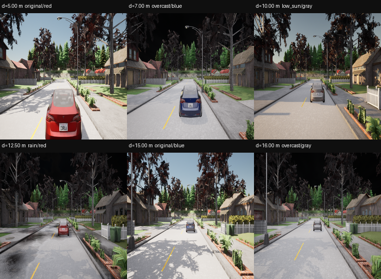
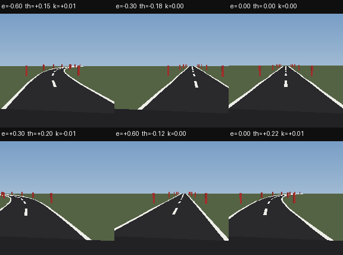
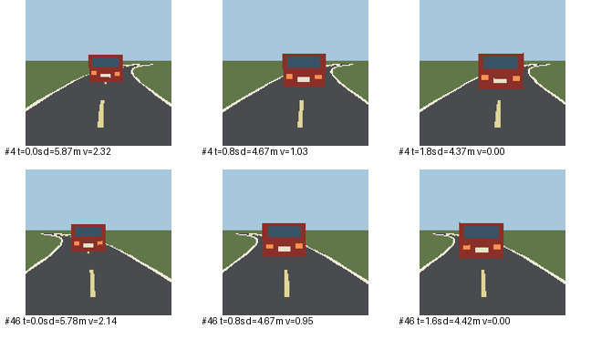
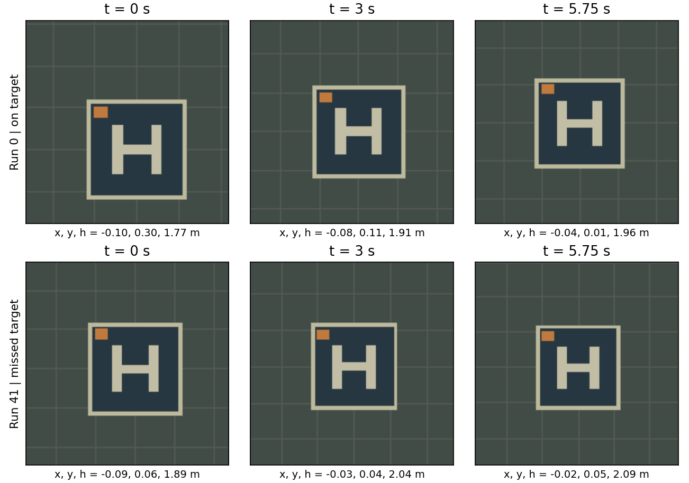
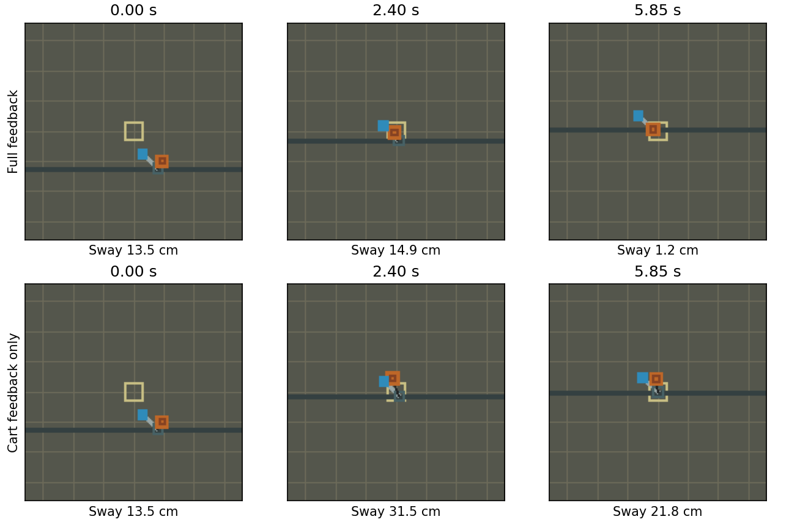
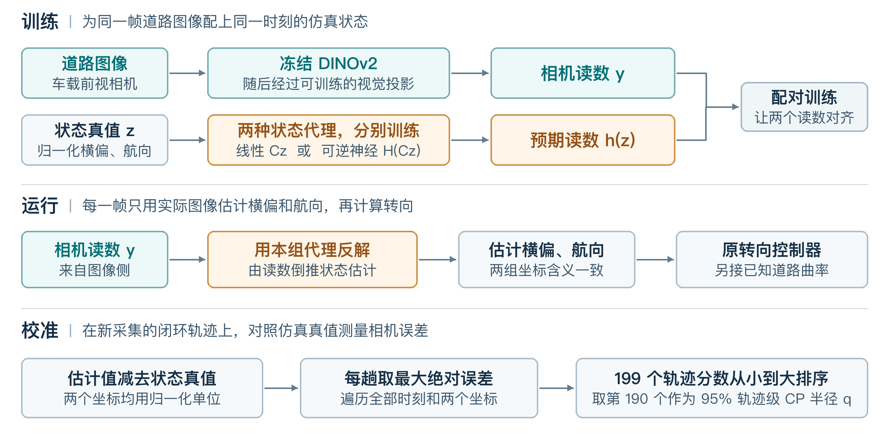
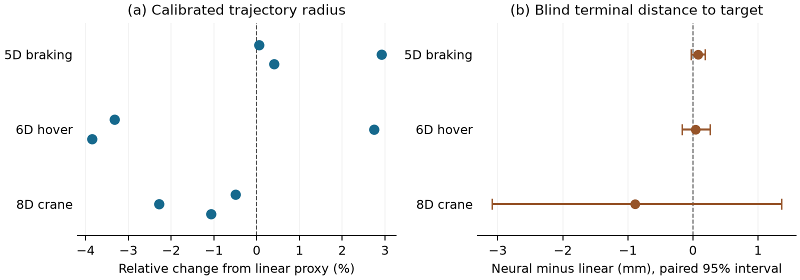
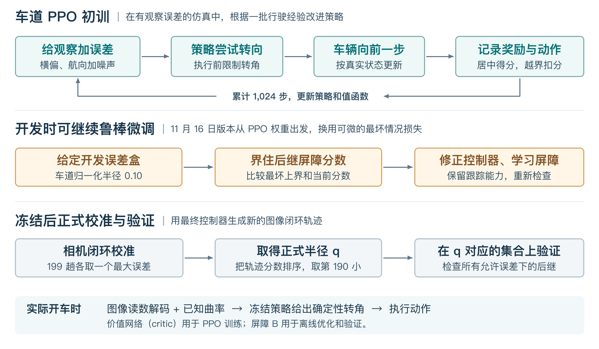
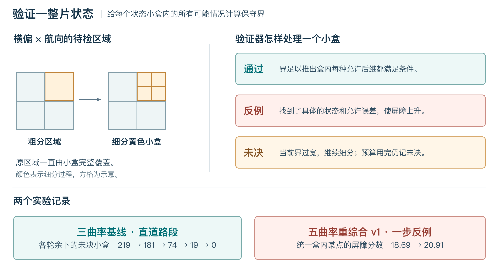

# 三个新增场景

## 五个实验的状态

| 场景               | 完整物理状态 $\mathbf{x}_t$               | 相机估计的物理量                                                     | 控制时另外知道什么                                         |
| ---------------- | ----------------------------------- | ------------------------------------------------------------ | ------------------------------------------------- |
| 实验 1 自动紧急制动（2 维） | $(d,v)$                             | $d$：与前方目标的距离（m）                                              | $v$：实测车速（m/s）                                     |
| 实验 2 车道保持（2 维）   | $(e,\theta)$                        | $e$：相对车道中心的横向偏差（m）；$\theta$：车头相对道路切线的航向偏差（rad）               | 道路曲率 $\kappa$（m⁻¹）已知，车速固定为 4 m/s                  |
| 实验 3 弯道遇障制动（5 维） | $(e,\psi,d,v,\delta)$               | $e$：横偏（m）；$\psi$：航向偏差（rad）；$d$：车身中心到障碍物后表面的沿道距离（m）           | $v$：车速（m/s）；$\delta$：当前实际前轮转角（rad）；曲率 $\kappa$ 已知 |
| 实验 4 无人机悬停（6 维）  | $(p_x,p_y,p_z,v_x,v_y,v_z)$         | $p_x,p_y,p_z$：相对悬停目标的三轴位移（m）                                 | $v_x,v_y,v_z$：三轴实测速度（m/s）                         |
| 实验 5 起重机消摆（8 维）  | $(p_x,v_x,s_x,r_x,p_y,v_y,s_y,r_y)$ | 对两根水平轴 $i\in\{x,y\}$，$p_i$ 是小车相对目标的位置（m），$s_i$ 是吊载相对小车的摆移（m） | $v_i$ 是小车速度（m/s），$r_i$ 是吊载相对小车的摆速（m/s）            |

车道模型的 $\theta$ 与弯道制动模型的 $\psi$ 都表示车头相对道路的航向偏差，沿用各自实验记号。无人机的 $p_z=0$ 表示到达目标高度 2 m；起重机吊载的位置要用 $p_i+s_i$ 算出。下文将 $Cx$ 里的列向量记作 $x_{\mathrm{obs}}$，以便和完整物理状态 $\mathbf{x}_t$ 区分。它列出状态侧用来预测视觉读数的分量，各实验的取法和尺度见各自状态表下方。训练与校准时可从仿真状态或图像标签得到这些真值；实际控制时图像分支从相机得到低维读数 $y$。

### 实验 1　自动紧急制动（AEBS）

**本实验的状态向量**　$\mathbf{x}_t=(d,v)$

| 状态符号 | 物理含义 | 单位 | 控制器从哪里取得这个量 |
|---|---|---|---|
| $d$ | 与前方目标的距离 | m | 按当前车距、天气和车色从冻结的 CARLA 图库取前视图，由 DINO 距离头估计。 |
| $v$ | 本车纵向速度 | m/s | 由仿真车辆动力学更新，作为无测量误差的车速读数直接传给策略。 |

真实距离 $d$ 用于选图和核算误差；策略收到的是图像估计 $\hat d$ 的归一化值和车速 $v$。

**本实验的 $Cx$。** $x_{\mathrm{obs}}=(d/S,\ v)^\top$，$C$ 为 $1\times2$，输出一个名义视觉读数。$S$ 是视觉前端的距离尺度（RGB 版约 3.18272 m，灰度联合版约 3.23781 m）；$v$ 直接取以 m/s 表示的数值。

- **本节 RGB 基线**固定 $C=[1,0]$，所以 $Cx_{\mathrm{obs}}=d/S$。实际起作用的只有距离；车速通过单独的测速通道送给制动策略。
- **联合学习版**用 $C_d d/S+C_vv$。训练图只有距离标签，同图配 0、1.5、3 m/s 三个辅助速度；执行时用实测车速解码距离。RGB 版学得 $C_v\approx-0.00000844$，所以速度在名义视觉读数中的贡献很小。
- **RGB 神经代理静态对照**在上述线性项上加 $r_\phi(d/S)$；额外的神经网络只读取距离。

*图 1　不同车距、天气和车辆外观下的 CARLA 前视样例。图像用来估计车距，速度从另一条测量通道输入控制器。*

1. **任务和动作。** 车从 $d\in[15,16]$ m、$v\in[2.5,3]$ m/s 出发，每 0.05 s 决定一次纵向指令 $a$（m/s²，正值表示制动）。目标是在进入 5–6 m 距离区间时将速度降到 0.5 m/s 及以下。车在远处提前停住也安全，却没有完成这个任务。
2. **视觉与控制怎样接起来。** 最早的 400 张灰度图验证了一维估距能接回制动策略；换成 24,000 张 CARLA 原始 RGB 图后，图像经 DINO 和视觉投影得到 $\hat d$，策略读取 $(\hat d,v)$ 后输出 $a$。每次刹车会改变下一步的真实车距，再按该车距、当趟天气和车色从固定图库取图。
3. **得到的结果。** 在最初完整的 RGB 基线中，冻结策略，用 199 趟行驶校准全程最大绝对测距误差，再验证神经鲁棒屏障。半径 **0.4184 m** 下条件安全检查通过；独立 100 趟中，**99 趟**的误差全程在界内，**100 趟**完成制动。后文的 ±0.45 m 是后续配对比较使用的控制器容许量。

### 实验 2　车道保持

**本实验的状态向量**　$\mathbf{x}_t=(e,\theta)$

| 状态符号 | 物理含义 | 单位 | 控制器从哪里取得这个量 |
|---|---|---|---|
| $e$ | 车身参考点相对车道中心线的横向偏差 | m | 由当前状态渲染的前视车道图，经 DINO 图块特征和视觉投影估计。 |
| $\theta$ | 车头相对当前道路切线的航向偏差 | rad | 由同一帧前视图估计，道路边线的方向提供航向信息。 |

策略读取归一化的 $(\hat e,\hat\theta)$ 和场景给定的道路曲率 $\kappa$（m⁻¹）；车速固定为 4 m/s。前轮转角 $\phi$（rad）是策略输出。 

**本实验的 $Cx$。** $x_{\mathrm{obs}}=(e/(0.85\,\mathrm m),\ \theta/(0.30\,\mathrm{rad}))^\top$，两个分量均为无量纲数。$C$ 为 $2\times2$，输出两个数。最初基线取 $C=I_2$；后续可训练 $C$，或再接可逆网络 $H(Cx_{\mathrm{obs}})$。这三种版本使用相同的横偏和航向输入。曲率 $\kappa$ 单独送给转向策略，固定车速只用于车辆动力学。

*图 2　边线相对画面中心的位置和方向共同提供横偏与航向信息。车每次转向后，按实际到达的状态重新渲染下一帧。*

1. **任务和动作。** 以 4 m/s 在直道、左弯或右弯上行驶 8 秒。每趟的已知曲率 $\kappa$ 取 $0$ 或 $\pm0.01$ m⁻¹，每 0.1 s 更新一次前轮转角 $\phi$（rad）。起点横偏在 ±0.25 m 内，航向偏差在 ±0.06 rad 内；观察 80 步中能否持续将横偏保持在 ±0.85 m、航向偏差保持在 ±0.30 rad 的边界内。
2. **视觉与控制怎样接起来。** 保留 DINO 图块的空间位置，由画面估计 $(\hat e,\hat\theta)$。神经策略接收这两个量的归一化值和曲率 $\kappa$，输出转向指令。这里的 $\phi$ 是动作；到了下面的五维制动实验，实际轮角 $\delta$ 会从上一步延续到下一步，因此还要作为状态记下来。
3. **得到的结果。** 固定前端和策略，按 199 条完整轨迹重新校准。所得归一化半径 **0.090093** 对应横偏误差约 **±7.66 cm**、航向误差约 **±1.55°**。同一批 100 趟测试，旧半径 0.08 全程覆盖 **82 趟**，新半径覆盖 **95 趟**；**100 趟**实际均未越界。原神经屏障在新半径和三个曲率下均通过。这也是后文比较线性代理与神经代理的基准任务。

三个例子都在仿真中按实际动作更新状态，每一步从到达的新状态重新渲染相机图像。

| 新场景        | 给控制器的视觉信息           | 怎样才算完成任务                       | 100 次留出仿真的结果                                         |
| ---------- | ------------------- | ------------------------------ | ---------------------------------------------------- |
| 五维弯道遇障制动   | 离车道中心多远、车头朝向、前方障碍距离 | 车身保持在路内、避开障碍，并在指定区间停稳          | 固定力度制动 **22 次**停准；图像反馈制动和转向 **88 次**停准，**100 次**安全停稳 |
| 六维无人机悬停    | 相对停机坪的三维位置          | 在有风时飞到停机坪中心正上方 2 m，并连续保持位置和低速度 | 仅用速度 **3 次**达标；图像位置＋实测速度 **99 次**达标，两组均 **100 次**安全  |
| 八维起重机定位与消摆 | 小车的二维位置、吊载相对小车的二维摆移 | 6 秒内将吊载送到目标附近，同时压住摆动           | 保留视觉摆移反馈 **89 次**达标；只去掉这一项 **0 次**达标，两组均 **100 次**安全 |

### 实验 3　五维弯道遇障制动：车停住了，是否停在了合适的位置？

**本实验的状态向量**　$\mathbf{x}_t=(e,\psi,d,v,\delta)$

| 状态符号 | 物理含义 | 单位 | 控制器从哪里取得这个量 |
|---|---|---|---|
| $e$ | 车身参考点相对车道中心线的横向偏差 | m | 由当前前视弯道图经 DINO 和三维视觉头估计。 |
| $\psi$ | 车身朝向相对道路切线的航向偏差 | rad | 由同一前视图估计，道路线的走向提供航向信息。 |
| $d$ | 从车身中心到障碍物后表面的沿道距离 | m | 由同一前视图估计，障碍物的表观大小和位置提供距离信息。 |
| $v$ | 当前纵向车速 | m/s | 从车辆动力学状态读取，按准确测速处理。 |
| $\delta$ | 当前实际前轮转角 | rad | 从仿真转向执行器当前状态读取，按准确转角测量处理。 |

已知道路曲率 $\kappa$（m⁻¹）另行输入。策略输出纵向加速度（m/s²）及每行驶一米的转角改变量（rad/m）；下一步实际轮角由动力学累积。

**本实验的 $Cx$。** 五维状态中选前三项，顺序为横偏、航向偏差、沿道障碍距离。代理实际读取 $x_{\mathrm{obs}}=(e/(0.65\,\mathrm m),\ \psi/(0.19\,\mathrm{rad}),\ (d-4\,\mathrm m)/(2\,\mathrm m))^\top$。三个量均无量纲，障碍距离以 4 m 为中心。线性 $Cx_{\mathrm{obs}}$、仿射 $Cx_{\mathrm{obs}}+b$、可逆神经代理 $H(Cx_{\mathrm{obs}}+b)$ 都使用这三项，$C$ 均为 $3\times3$。车速 $v$、实际轮角 $\delta$ 和曲率 $\kappa$ 直接提供给控制器。

*图 3　每行是一次实际执行的仿真，从左到右为起步、中段、停稳。d 是车身中心沿道路到障碍物后表面的距离，v 是车速。上排第 4 号停在目标区；下排第 46 号停早了。*

1. **场景与任务。** 车已经进入制动接近段，前方有静止障碍，车道向左或向右弯，半径 50 m。车辆以 2.10–2.40 m/s 起步，与障碍相距 5.30–5.90 m。在 2.8 秒、14 次控制内，要让整车留在车道内、与障碍保持间隙，并让车身中心在距障碍 **3.60–4.40 m** 的范围内停下。
2. **输入与动作。** 五个状态为横向偏差、航向偏差、障碍距离、车速、实际前轮转角。前视图像经 DINO 和视觉投影估计前三项；车速和转角假设准确测得，道路曲率已知。神经控制器根据这些读数决定制动力度和转角变化。它通过模仿制动与跟踪规则训练，输出端保留了近障最低制动力。
3. **对照说明了什么。** 相同 100 个初态下，固定力度制动有 **22 次**停准；只让制动力随图像变化就有 **89 次**；再启用转向有 **88 次**，平均横偏由 **4.36 降至 4.12 cm**。完整控制剩余的 12 次全部停早。这个短距离场景里，停车精度的主要改善来自按图像调节制动力。
4. **证明了什么。** 验证器把车身尺寸和剩余停车距离写进结构化神经屏障。只要真实视觉误差全程落在校准范围内，在登记模型的采样时刻，整车到车道线的距离下界约为 **6.58 cm**，与障碍的沿道分离余量下界约为 **8.57 cm**。神经代理版有 **96/100** 条留出轨迹全程满足误差前提。两项余量是模型下的保守下界，88/100 是实测停车精度。

### 实验 4　六维无人机悬停：速度降到零时，飞机停在哪里？

**本实验的状态向量**　$\mathbf{x}_t=(p_x,p_y,p_z,v_x,v_y,v_z)$

| 状态符号 | 物理含义 | 单位 | 控制器从哪里取得这个量 |
|---|---|---|---|
| $p_x$ | 相对悬停目标沿水平 x 轴的位移 | m | 由下视图中停机坪标志的位置估计。 |
| $p_y$ | 相对悬停目标沿水平 y 轴的位移 | m | 由同一帧下视图估计另一水平方向的位移。 |
| $p_z$ | 相对目标高度 2 m 的竖直位移 | m | 由下视图中已知尺寸标志的表观大小等图像线索估计。 |
| $v_x$ | 沿水平 x 轴的速度 | m/s | 仿真三轴速度通道直接提供 x 分量，假设准确。 |
| $v_y$ | 沿水平 y 轴的速度 | m/s | 仿真三轴速度通道直接提供 y 分量，假设准确。 |
| $v_z$ | 沿竖直 z 轴的速度 | m/s | 仿真三轴速度通道直接提供 z 分量，假设准确。 |

表中列物理单位。实现分别按三轴长度尺度 $(0.75,0.65,0.50)$ m 归一化位置和速度后做反馈；$p_z=0$ 表示飞机正在目标高度。 

**本实验的 $Cx$。** 只取相对悬停目标的三个位置分量，$x_{\mathrm{obs}}=(p_x/(0.75\,\mathrm m),\ p_y/(0.65\,\mathrm m),\ p_z/(0.50\,\mathrm m))^\top$。$p_z$ 是实际高度减去 2 m，三个缩放后的数均无量纲。可训练的 $3\times3$ 线性矩阵将它们映射为三维名义读数。控制器把视觉读数解码为位置，再单独读取三个速度分量。

*图 4　每行是一次飞行，三列依次为开始、中段和最后一次相机观测。停机坪标志偏离画面中心反映水平偏移，标志大小还提供高度信息。下排第 41 号全程安全，但末段高度偏差最大达 9.59 cm，超过 ±9 cm 的任务容差。*

1. **场景与任务。** 无人机从略微偏离目标的位置起飞，在持续风偏和阵风下执行 24 次控制，共 6 秒。六维是三个方向的位置和速度。飞机要始终处于安全空间内，最后连续四个采样时刻还要同时满足三轴的位置和速度容差。
2. **输入与动作。** 下视相机从已知尺寸的停机坪标志估计三维位置，三轴速度由传感器提供。控制器输出三个方向的加速度。位置反馈负责把飞机拉回中心，速度反馈负责抑制冲过目标后的漂移。此次使用带限幅的比例–微分反馈，假定姿态内环能够执行这些指令。
3. **对照说明了什么。** 给两组飞机相同的起点、风向和逐步阵风。只保留速度反馈时，飞机可以慢下来，却平均停在离目标 **36.43 cm** 处，只有 **3/100** 达标。加入图像位置后，终点平均距离降到 **6.23 cm**，**99/100** 达标。若提供精确位置作为参照，平均为 **5.28 cm**，**100/100** 达标。
4. **证明了什么。** 用位置和速度共同构造屏障，检查任意允许视觉误差与有界风扰共同出现时，下一步仍在安全区域。图像组 **95/100** 条全程在校准界内，**100/100** 条实测安全。证书保护位置和速度边界；最后能否在中心附近悬稳，用更严格的任务容差另行统计。

### 实验 5　八维桥式起重机：小车到了，吊载是否还在摆？

**本实验的状态向量**　$\mathbf{x}_t=(p_x,v_x,s_x,r_x,p_y,v_y,s_y,r_y)$

| 状态符号  | 物理含义             | 单位  | 控制器从哪里取得这个量                       |
| ----- | ---------------- | --- | --------------------------------- |
| $p_x$ | 小车相对目标在 x 轴的位置   | m   | 俯视图定位蓝色小车标记，校正已知安装偏移后取 x 坐标。      |
| $v_x$ | 小车沿 x 轴的速度       | m/s | 从小车速度通道准确读取仿真值。                   |
| $s_x$ | 吊载相对小车在 x 轴的水平摆移 | m   | 俯视图定位橙色吊载，用吊载 x 坐标减去同图估计的小车 x 坐标。 |
| $r_x$ | 吊载相对小车沿 x 轴的摆移速度 | m/s | 从独立摆速通道准确读取仿真值。                   |
| $p_y$ | 小车相对目标在 y 轴的位置   | m   | 俯视图定位蓝色小车标记，校正已知安装偏移后取 y 坐标。      |
| $v_y$ | 小车沿 y 轴的速度       | m/s | 从小车速度通道准确读取仿真值。                   |
| $s_y$ | 吊载相对小车在 y 轴的水平摆移 | m   | 俯视图定位橙色吊载，用吊载 y 坐标减去同图估计的小车 y 坐标。 |
| $r_y$ | 吊载相对小车沿 y 轴的摆移速度 | m/s | 从独立摆速通道准确读取仿真值。                   |

摆移 $s_i$ 是水平位移，摆速 $r_i$ 是该位移的变化率。沿任一水平轴 $i$，吊载相对地面目标的位置等于 $p_i+s_i$。 

**本实验的 $Cx$。** 从按轴排列的八维状态中取第 **1、5、3、7** 项，依次是两个方向的小车位置和两个方向的吊载摆移。按代码数值，$x_{\mathrm{obs}}=(p_x,\ p_y,\ s_x/0.5,\ s_y/0.5)^\top$，式中的长度都先用米表示：小车位置保留米制数值（等效尺度 1 m），摆移按 0.5 m 缩放。$C$ 为可训练的 $4\times4$ 正交矩阵，输出四维名义读数。小车速度 $v_x,v_y$ 及摆速 $r_x,r_y$ 由独立速率通道提供给控制器。

*图 5　蓝色标记表示小车，橙色表示吊载，浅色框是目标。上排使用完整反馈，下排只使用小车的位置与速度；两排初态和外扰相同，图下标注当时的摆幅。下文的“只去掉视觉摆移”还保留摆速反馈，是另一组更严格的对照。*

1. **场景与任务。** 小车要沿两个水平方向把吊载送到目标。小车一加速，吊载会滞后并摆动。每个方向记录小车位置、车速、吊载相对小车的摆移、摆速，共八维。6 秒内执行 40 次控制；末四个时刻要求吊载每轴距目标不超过 **9 cm**，摆移不超过 **5.5 cm**，并满足速度要求。
2. **输入与动作。** 俯视相机读取两个标记，解码出小车位置和吊载摆移共四个量；车速与摆速单独测量。控制器用线性二次调节器（LQR）求出的反馈增益，给小车两个水平加速度。它既要向目标移动，也要根据当前摆向调整加速方向，两轴共用电机加速度预算。
3. **对照说明了什么。** 在同一批起点和外扰下，完整反馈末段平均摆幅为 **1.28 cm**，**89/100** 达标。仅去掉视觉摆移项、保留测得的摆速，平均摆幅增至 **10.01 cm**，**0/100** 达标。图示的“仅小车反馈”组平均为 **14.79 cm**。完整组的 11 次未达标，均因末段吊载位置至少一次超出目标容差。
4. **证明了什么。** 给定当前时刻，计算从现在到第 40 步，所有允许误差与外扰下最接近哪条限制，包括吊载净空和电机总预算。把限值当作 1，全部登记初态的最坏用量上界是 **0.77686**，随后也不会超过 1。完整组 **97/100** 条留出轨迹全程在视觉误差界内。0.77686 表示约束占用比例，与达标率和安全概率的单位都不同。

## 三、把 Cx 换成神经代理后效果

设想车在中心线右侧 **20 cm**，相机读数解码后报 **18 cm**。控制器会按 18 cm 来转向。这一帧的**视觉估计误差**是 −2 cm，车本身的**横向跟踪偏差**是 20 cm。前者决定验证器要包容多大的误差，后者衡量车开得怎么样。下面用同一套实验同时测这两件事。这里的 20 cm 和 18 cm 仅用来说明读数的含义。

*图 6a　训练时，同一帧有图像和仿真真值，两路各算一个低维读数。开车时，从图像读数反推横偏和航向，再送给原转向控制器。离线校准能看到真值，因此可以把每帧估错了多少记下来。*

### 两条读数怎样对齐，再接回原控制器？

1. **训练时，从两条路看同一个状态。** 图像经冻结的 DINO 和可训练的视觉投影得到读数 $y$。状态侧只取相机要估计的量，归一化后记作 $z$（即前文的 $x_{\mathrm{obs}}$）。车道的 $z$ 有横偏和航向两个分量。线性组用可训练矩阵 $h(z)=Cz$ 预测 $y$；神经组在同一个线性层后接可逆小网络，得到 $h(z)=H(Cz)$，允许同样的横移在不同航向下引起不同的读数变化。两组各自联合训练视觉投影和代理，让实际读数与预测读数对齐。
2. **运行时，从相机读数倒推物理量。** 线性组算 $C^{-1}y$，神经组算 $h^{-1}(y)$，都得到横偏和航向的估计 $\hat z$。曲率仍从原通道输入，同一个控制器据此转向，车辆到达的新位置决定下一帧相机图像。在起重机上同理，八维状态中只对相机负责的四个量解码，即两轴小车位置和两轴吊载摆移。
3. **校准时，找出一整趟里估得最差的一次。** 刚才的 2 cm 除以车道横偏的尺度 85 cm，得到该帧该坐标的绝对误差约 0.024。再看这一趟其余时刻和航向坐标，取最大值，整趟只记一个数。对 199 趟校准轨迹排序，取第 190 小的数作为 95% 轨迹级 CP 半径 $q$。误差管要求每个时刻的每个坐标都满足 $|\hat z_j-z_j|\le q$。由于 $y=h(\hat z)$，给定 $z$ 时，这也限定了实际低维读数 $y$ 可以偏离代理预测 $h(z)$ 的范围。验证器把管内所有允许误差都带进闭环检查。

### 四个闭环任务放在一起看

每个任务做三对训练，每对共用训练图、视觉头初值、批次和更新次数，神经组增加了可逆层的参数。例如车道两组都用 3,600 张图训练 30 轮，神经版多 98 个参数。冻结后，每个模型各跑 199 趟校准，再在配对的 100 个新场景中盲测。表中箭头均为**线性 → 神经**。$q$ 用本任务归一化坐标表示，适合在同行内比较。

| 任务      | 整趟视觉误差半径 $q$（三对均值）                   | 开得、飞得或停得怎样？                             | 鲁棒验证得到什么？                                                    |
| ------- | ------------------------------------ | --------------------------------------- | ------------------------------------------------------------ |
| 车道保持    | 0.08890 → 0.08447，两对变小               | 车辆离中心线的平均距离 **36.28 → 34.26 mm**，三对都更居中 | 六个模型在各自的 $q$ 和三种道路曲率下均通过同一神经屏障检查                             |
| 五维弯道制动  | 0.130877 → 0.132352，三对都变大（均值 +1.13%） | 三对停准数为 **86→86、88→88、87→87**，每对逐场景结果也相同 | 六个模型均在各自的 $q$ 下通过制动屏障检查                                      |
| 六维无人机悬停 | 0.225726 → 0.222218，两对变小（均值 −1.55%）  | 三对的两组都 **100/100** 达到末段稳定悬停要求           | 六个模型均在各自的 $q$ 下通过含风扰的验证                                      |
| 八维桥式起重机 | 0.190949 → 0.188459，三对都变小（均值 −1.30%） | 三对到位并消摆的次数为 **99→100、97→95、99→99**      | 六个模型均通过；冻结各自的误差管，可证初态范围的平均线性倍率 **1.37175 → 1.37586（+0.30%）** |

车道上，**2.02 mm（5.56%）** 衡量车身实际更靠近中心线的幅度。同一批留出场景里，整趟视觉误差都在各自管内的比例却从平均 **96.67% 降到 93.67%**。起重机上，三对都扩大了可证初态范围，达标数则有升有降。前文起重机去掉吊载摆移反馈的实验改变了控制器能看到的信息；本表的两组都能看到摆移，比较的是怎样把它从图像中读出来。

*图 6b　左图一个点对应一对训练。起重机的三个点都在零以下，表示换代理后，验证器每次需要包容的误差都小了一点。右图比较同一场景下离目标终点的物理距离，三个任务的配对均差 95% 区间都跨过零。*

**这些差异能归给谁？** 四个任务评估的是联合训练后的整套前端。进一步把已学到的神经映射用“矩阵加偏置”近似，在实验访问的区域内仍能得到接近的解码结果，因此现有数据难以把车道的 2.02 mm 改善单独归给非线性。早期五维制动还试过单个训练种子的线性、加偏置和神经三组，半径分别为 0.12415、0.12510、0.12506，三组都 88/100 停准并通过验证。RGB AEBS 则只在冻结的视觉头上做过静态对照，神经残差使等效匹配误差平均少约 0.07 mm；这项试验只能回答同一张图上的匹配问题。

## 四、现在的安全保证换成了什么？

**现在采用“轨迹级保形预测(CP)＋确定性鲁棒屏障”**

 **SBC** -> **CP** + **Robust Barrier Certificate**

|          | 原 SPVC 的随机屏障证书（SBC）                           | 当前实验的保证                                                  |
| -------- | --------------------------------------------- | -------------------------------------------------------- |
| 怎样处理不确定性 | 对模型规定的随机后继扰动给出概率分布                            | 用完整相机轨迹校准视觉与代理的误差集合；风、驱动扰动再按各任务的已知界处理                    |
| 屏障实际检查什么 | 在定理要求的状态，按扰动概率取平均，下一步屏障值的**条件期望**须比当前值有正的下降裕量 | 对集合内**每一种允许误差与扰动**检查安全保持。车道、五维制动检查 B 下一步不增；起重机比较相邻时刻的 Bₜ |
| 最终怎样读    | 在论文规定的随机动力学和定理条件下，从屏障推出避开危险集的概率下界             | 对登记初态和离散动力学，只要误差全程在界内且外扰符合假设，各采样时刻都避开相应危险。概率来自整轨迹误差覆盖    |

**为什么后继不增能证明安全？** 用五维制动做例子。所有登记起点的屏障分数至多是 1；如果车身触碰车道或障碍危险边界，分数至少是 20。假如每一步允许的视觉误差都不能让分数升高，从至多 1 出发就走不到至少 20 的状态。网络仍然可以表示这个屏障；“鲁棒”指检查覆盖每一种允许误差。无人机用位置和速度构造屏障，起重机用剩余时域的最坏约束用量构造屏障，起重机的危险阈值为 1。

**95% 和 100 次试验分别说明什么？** 每条轨迹只记一个分数，即各时间、各视觉坐标中最大的归一化误差。199 条校准轨迹取第 190 小的数作为 q。如果冻结模型、初始化、相机及扰动采样方案后，校准轨迹与未来整条轨迹可交换，CP 给出至少 **95% 的整轨迹边际覆盖**，概率同时计入校准集与新轨迹的抽样。在其余建模假设成立时，“验证接受证书，且新轨迹仍在规定时域内越界”的联合概率至多 5%。固定当前这一次 q 后的条件事故率需要另一个结论。

用起重机的 **100 次留出**读这段话最直观：**97 次**误差全程在界内，这些运行可逐条套用证书；**100 次**实际都安全；**89 次**还做到了在指定时间内到位并消摆。三个数字依次回答“证明的前提是否满足”“这批实际有没有越界”“任务完成得怎么样”。保证适用于登记的仿真相机、动力学、传感器与采样时刻；这批结果没有检验实机或两个采样时刻之间的安全。
、
车道提供了另一个实例。旧的 ±0.08 归一化误差界覆盖 **99.725% 的帧**，但同一批 100 趟行驶中，只有 **82 趟**全程在界内。改为按整趟最差一帧校准，半径扩到 **0.090093**，全程覆盖增至 **95 趟**；固定原来的策略和屏障，在新半径下重新验证也通过。因此可以解释，新增的 13 趟覆盖来自调整误差界，且控制器确实承受得住这项调整。这个数是当前框架内部对校准方式的检验。

## 五、PPO 怎样学会转向？CP 误差和屏障在哪一步用到？

沿用第三节的例子。车实际向右偏 **20 cm**，相机只报 **18 cm**。训练时，希望控制器凭一个有偏差的读数也能把车开回中心。验证时，问题更严格：如果允许的误差每一步都让车朝最不利的方向转，它还能守住边界吗？项目里先用 PPO 学一个候选策略，有的版本再用屏障指导它修改转向，最后才对冻结系统作这个检查。

*图 9　跟着策略权重看。初训的反馈是每步奖励，鲁棒微调的反馈来自开发误差盒内可能出现的屏障增长，最终校准面对的是冻结策略实际开出来的图像轨迹。部署时每一帧由 actor 输出转向。*

### 一次 PPO 更新是怎样发生的？

1. **给策略一辆车和三个读数。** 最初的车道仿真以 4 m/s 行驶，每 0.1 s 决策一次，每回合最多 80 步。横偏 $e$ 除以 0.85 m，航向偏差 $\theta$ 除以 0.30 rad，曲率 $\kappa$ 除以 0.01 m⁻¹。策略收到这三个数。训练环境在前两个读数上分别从 $[-r_{\rm train},r_{\rm train}]$ 均匀抽一个误差，曲率准确给出。这样可以反复练习看偏时怎样转向。此阶段直接在读数上造扰动，真实仿真位置照常推进；部署时由道路图像、DINO 和解码器提供前两个数。[观察误差的注入位置](../../artical-F122/Aebs/lane_keeping/env.py)
2. **试一次转向，看接下来开得怎样。** *Actor* 是给出动作的策略网络。训练时从策略的动作分布采样，环境把归一化动作 $a$ 裁到 $[-1,1]$，再乘 0.45 得到实际前轮角 $\phi$，单位为弧度。例如，若采到 $a=-0.4$，这一仿真步执行 $-0.18$ rad。车辆模型从**真实状态**推进一步，根据下一步的真实横偏和航向以及本步转角给奖励。即使网络低估了横偏，打分时仍按车辆实际开到的位置算。[车辆更新、动作裁剪与奖励](../../artical-F122/Aebs/lane_keeping/core.py)
3. **让有利的动作更容易再被选到。** *Critic* 是训练用的价值网络，估计从当前观察出发，往后能积累多少奖励。PPO 把收集的后续奖励和价值估计结合，算出一个动作比预期好多少，称为“优势”。有利动作的概率通常上调，不利动作的概率通常下调。裁剪目标限制大幅改变新旧动作概率比所能获得的额外收益，使同一批行驶数据可以用于几轮小更新。价值网络预测回报，安全屏障分隔初态和危险区，两者的输出含义不同。[PPO 原论文](https://arxiv.org/abs/1707.06347) · [项目训练入口](../../artical-F122/Aebs/lane_keeping/train_ppo.py)
4. **重复采样、更新，最后导出能执行的 actor。** 原策略网络有两层各 64 个 Tanh 单元。每轮收集 1,024 个环境步，以 256 条为一小批更新 10 遍；学习率 0.0003，折扣 0.99，优势估计参数 0.95，裁剪参数 0.2。请求 80,000 步，按完整批次保存时实际为 **80,896 步**。部署和验证取策略的确定性动作均值并裁剪，运行时只需 actor。早期在三种固定曲率各 10 趟、另加 10 趟混合曲率的带噪仿真中都未越界；这些是 40 趟经验评价。[原始训练记录](../../artical-F122/results/lane_keeping_20261105/ppo_image/metrics.json) · [确定性策略导出](../../artical-F122/Aebs/lane_keeping/policy.py)

### 哪些限制真的逐步生效？

| 量             | 怎样进入程序                                                                    | 一次训练中实际会发生什么                                             |
| ------------- | ------------------------------------------------------------------------- | -------------------------------------------------------- |
| 转角上限          | 每步强制裁剪，$\phi=0.45\,\mathrm{clip}(a,-1,1)$ rad                             | 即使网络给出 1.2，也只执行 +0.45 rad，约 25.8°。                       |
| 居中、对准道路、少打大角度 | 每步奖励为 $1-0.5(e'/0.85)^2-0.2(\theta'/0.30)^2-0.02(\phi/0.45)^2$，撇号表示运动后的真值 | 同样能走完一趟，更靠近中心、朝向更正、转角更小的开法得分较高。奖励惩罚转角幅值，没有专门限制相邻两步转角变化率。 |
| 车道危险边界        | 更新后若横偏绝对值超过 0.85 m 或航向偏差绝对值超过 0.30 rad，再扣 10 分并结束回合                       | 训练允许发生失败，扣分使这类行为较少得到鼓励。“坚持 80 步未越界”也允许车辆有残余横偏。           |
| PPO 裁剪参数 0.2  | 用在优化目标里的新旧动作概率比                                                           | 限制一次策略更新的激励。车辆的物理转角限制由第一行单独执行。                           |

### 训练噪声、屏障反馈和最终 CP 是三次不同的操作

| 版本和时刻                           | 此时知道什么                                                                                   | 怎样影响策略或证书                                                                                                                                                                                                                                                                                                                                                      |
| ------------------------------- | ---------------------------------------------------------------------------------------- | -------------------------------------------------------------------------------------------------------------------------------------------------------------------------------------------------------------------------------------------------------------------------------------------------------------------------------------------------------------- |
| **11 月 5 日，原 PPO 初训**           | 入口从配置读取工程噪声半径。同期同路径评估记录的是 **0.30**，对应横偏 ±25.5 cm、航向 ±0.09 rad。训练日志只保存了临时文件路径，未保存当时文件的哈希。 | 盒子用来产生带误差的观察，PPO 仍按驾驶奖励更新。均匀抽样是训练选择，CP 本身只给覆盖界。初训没有把屏障写进奖励，也没有逐动作运行安全过滤器。[训练记录](../../artical-F122/results/lane_keeping_20261105/ppo_image/metrics.json) · [同期评估](../../artical-F122/results/lane_keeping_20261105/verification/evaluate_image_conservative.json) · [工程误差盒](../../artical-F122/results/lane_keeping_20261105/cp/cp_conservative.json)          |
| **11 月 7 日，车道基线**               | 原 PPO 权重已冻结，前端实际驱动车辆，得到 199 趟新校准轨迹。                                                      | 用整趟最大视觉误差校准得 $q=0.090093$，交给验证器检查原策略和屏障。此步骤不更新策略。它对应第一节车道的 95/100 趟留出轨迹入盒。[冻结协议](../../artical-F122/results/lane_trajectory_cp_20261107_v1/protocol.json) · [校准与留出结果](../../artical-F122/results/lane_trajectory_cp_20261107_v1/report.json)                                                                                                                   |
| **11 月 16 日，车道鲁棒综合**            | 从原 PPO 权重起步，先指定开发误差半径 **0.10**（±8.5 cm、±0.030 rad）。开发时已有候选屏障 $B$ 指导修改转向。                 | 对开发状态，将整块误差经 actor、车辆方程和屏障传到下一步，惩罚最坏情况下 $B$ 的正增长，再加模仿原策略及一步跟踪的损失。用梯度直接改 actor，共 6 轮、每轮 100 次，随后为新策略训练新屏障。开发表现退化时可缩小更新或回滚。最终冻结后另采轨迹，得 **$q=0.099687$**，三种曲率全部通过，98/100 趟留出轨迹全程在管。这是屏障参与**控制器优化**的一步，采用鲁棒损失。[控制器更新代码](../../artical-F122/Aebs/lane_keeping/refine_actor.py) · [本轮正式报告](../../artical-F122/results/lane_robust_synthesis_20261116_v2/report.json) |
| **11 月 17 日，第三节的 $Cx$ 与神经代理配对** | 六个车道前端共用上一步微调完成的同一 actor 和同一个新屏障。                                                        | 每个前端驱动自己的闭环、独立校准自己的 $q$，在自己的误差管上重新验证。六组之间固定控制器，因而能比较前端的作用。[三对模型冻结协议](../../artical-F122/results/lane_proxy_comparison_20261117_v1/protocol.json)                                                                                                                                                                                                               |

一旦更新控制器，车辆到达的位置和拍到的图都可能改变。因此，开发时可以用已有误差盒练习转向；要对**最终闭环**报告 95% 轨迹覆盖，就在前端和策略都确定后用新轨迹校准。运行时 actor 接收图像估计和曲率，$q$ 与 $B$ 用于离线校准和验证。其他任务各有自己的控制器来源：RGB AEBS 复用制动策略并另做过鲁棒微调；五维制动用教师示范学习刹车和转向；六维悬停用限幅位置–速度反馈；八维起重机用 LQR 增益。上面的 PPO 奖励、步数和转角限制专属于车道。[AEBS 与车道鲁棒综合](../experiments/跨实验对照/AEBS与车道_旧前端鲁棒综合_20261116.md) · [五维控制器训练](../experiments/五维弯道制动/五维弯道遇障制动_视觉代理与鲁棒屏障_20261117.md)

## 六、验证器怎样把“相机可能看错”算成一个安全结论？

以 **11 月 7 日三曲率车道基线**为例。验证器的输入是冻结的确定性 actor、一个候选神经屏障 $B$、车辆方程、初始区域、危险边界和 CP 误差盒。它要回答：从登记的起点出发，若每一帧读数的误差都在盒内，车辆能否始终留在安全边界内？一趟相机盲测只给出一种误差序列、一条转向路径；验证器要覆盖每一步所有允许的选择。

*图 10　一个状态格代表整片横偏和航向。区间比较足够紧时可一次判定整格；界太宽时继续细分；找到一组确切的状态和误差使屏障升高时，就有了推翻该候选的见证。图中的直道细分记录与五曲率反例来自两个注明的实验。*

### 先明确要验证的三条条件

- **起点。** 对登记的全部起点（横偏 ±0.25 m、航向 ±0.06 rad），要求 $B(x)\le1$。
- **危险。** 在可能首次触碰或越出车道安全边界的区域，要求 $B(x)\ge20$。用速度、步长和轮角上限可以包住安全矩形内任一点一步能到的最远位置。归一化后的两个坐标绝对值分别小于 1.140 和 1.262，检查到 ±1.3 的外圈足以包住首次越界。
- **一步。** 在安全方形内且 $B(x)\le20$ 的状态，对当前误差盒内的**每一种** $\delta$，都要求 $B(x')\le B(x)$。这里 $x'$ 由确定性策略看到 $x+\delta$ 后的动作、真实状态和已知曲率共同确定。每趟曲率固定，对 $-0.01,0,+0.01$ m⁻¹ 三种情况分别检查。

为什么这三条就够？假设有一次首次越界。出发时分数最多为 1，一步又一步都不能涨，那么首次越界时仍应最多为 1。但首次越界处的分数至少是 20，同一个状态不可能同时满足这两个数。这里 $B$ 是为证明学到的标量，1 和 20 是分隔阈值。屏障值本身没有“碰撞概率”的单位。[三条检查与首步可达范围](../../artical-F122/Aebs/lane_keeping/verify_learned.py)

### 跟着一个真实小格走完验证

本轮半径 $q=0.090093$ 对应**横偏估计误差约 ±7.66 cm，航向估计误差约 ±1.55°**。验证器把归一化状态域先划为 $40\times40$ 个完整小矩形，再把二维误差盒沿每个方向分四段，共 16 个小误差盒。下表用归档模型复算直道中包含“真实右偏 20 cm、航向偏差 0.005 rad”的那个格。表内物理数是约数，程序用未取整的界判定。

| 步骤              | 送入什么                                       | 这一格算出了什么                                                                                  |
| --------------- | ------------------------------------------ | ----------------------------------------------------------------------------------------- |
| 1. 选真实状态格 $X$   | 横偏 **17.00–21.25 cm**，航向偏差 **0–0.015 rad** | 包含这个矩形里的每一种真实位置和朝向。                                                                       |
| 2. 加视觉误差，算可能动作  | $X$ 加上各个误差子盒，再附上直道曲率 0，传入同一个 actor         | 相机可能报告横偏约 **9.34–28.91 cm**。合并 16 个子盒后，前轮角约在 **−0.450 到 −0.022 rad**。                     |
| 3. 推进真实车辆 0.1 秒 | 把上述动作区间与真实状态格送入车辆方程                        | 包住的后继横偏约 **17.00–21.85 cm**，航向约 **−0.0744 到 0.0116 rad**。向左打轮也允许这一小步继续右移，因为本步横向位移取决于已有航向。 |
| 4. 比较屏障         | 分别求当前格内 $B$ 的下界和所有允许后继 $B$ 的上界             | 当前整格 $B=0$，后继上界也为 **0**。于是格内任一点、配任一合法视觉误差，都满足这一步不增。                                       |

上述传播包含连续区间内的网络输出和非线性车辆运动。实现对 Tanh 网络计算包住所有输出的界，再对所有误差子盒取最大的后继屏障上界。用区间包住一组精确状态时，会把某些实际上不能同时出现的极端值也纳入，所以粗格可能暂时无法比较。[区间传播和误差子盒](../../artical-F122/Aebs/lane_keeping/learned_sbc.py) · [本次归档模型与仿射界审计](../../artical-F122/results/lane_trajectory_cp_20261107_v1/audit/certificate.json)

### 怎样区分“还没证出来”和“这份证书确实不成立”？

| 验证器看到什么 | 接下来怎样处理 |
|---|---|
| 后继 $B$ 上界不高于当前 $B$ 下界，或后继上界为零且 $B$ 非负 | 整格通过。若当前格的 $B$ 下界已大于 20，则该格在一步条件要求检查的活跃域之外。 |
| 上界太松，仍可能增长 | 细分真实状态格再算。直道的 1,600 个初始格中，第一层有 **219** 个未决；之后依次剩 **181、74、19、0** 个。计算预算用尽仍有未决，就不能签发该证书。 |
| 找到具体的 $x,\delta$，代回原网络和动力学，确有 $B(x')>B(x)$ | 这对数直接推翻当前不增条件。实际例子来自另一次**五曲率 v1 统一盒**实验：直道归一化状态约 $(-0.825,0.675)$，两个视觉坐标的误差均约为 −0.38026，屏障从 **18.69000 升到 20.91071**；同期 100 条盲测均未越界。这个见证否定候选屏障的全域条件，是否存在从登记起点出发的越界轨迹仍需另证。后续五曲率 v2 补偿并重训后，统一盒在零额外转向扰动下通过。[实际反例](../../artical-F122/results/lane_paired_synthesis_20261117_v1/uniform/audit.json) · [五曲率 v2 审计](../../artical-F122/results/lane_paired_synthesis_target_20261117_v2/uniform/audit.json) |

对三曲率基线，最终算得初始屏障上界 **0.085828 ≤ 1**、危险外圈下界 **23.653496 ≥ 20**，三种曲率均无未决。另用普通区间传播（IBP）复算，得到较松的 **0.607153** 和 **20.140602**，也满足阈值。两条路径共享模型和部分实现。这是覆盖连续状态和连续误差的浮点数值检查，尚未逐运算实施 IEEE 向外舍入。[仿射界原始结果](../../artical-F122/results/lane_trajectory_cp_20261107_v1/audit/certificate.json) · [普通区间复算](../../artical-F122/results/lane_trajectory_cp_20261107_v1/audit_ibp/certificate.json)

### 换到别的任务，验证器具体检查什么？

| 任务 | 同一原则怎样落到本任务 |
|---|---|
| RGB AEBS | 把真实车距、车速和测距误差送入闭环模型，包住仍在行驶时的一步后继，按规定停车终止。鲁棒综合版先对 **±0.45 m** 做了 **782,400** 个区间的检查。冻结模型后的新 $q=0.405193$ m 被已验证集合完整包含，核对模型身份后可复用这份证明。[AEBS 开发验证和最终包含检查](../experiments/跨实验对照/AEBS与车道_旧前端鲁棒综合_20261116.md) |
| 五维弯道制动 | 用车身几何、最坏测距和最低减速度建立结构化屏障，逐项约束横移、航向变化、停车进度。原任务条件下得到了整车距车道边界至少 **6.58 cm**、距障碍至少 **8.57 cm** 的采样时刻余量。[五维验证器](../../artical-F122/Aebs/curve_braking/verify.py) |
| 六维无人机悬停 | 利用位置与速度组合，逐轴检查最坏视觉偏差和风扰共同作用后仍满足位置、速度和推力条件，关键不等式用有理数复算。末段能否稳定悬在中心另用任务指标评价。[六维验证器](../../artical-F122/Aebs/visual_hover/certificate.py) |
| 八维桥式起重机 | 根据每步可达状态，包住剩余时域（最多 40 步）内的净空、电机命令等约束用量，比较相邻时刻的屏障 $B_{t+1}$ 和 $B_t$。这里的上限是 **1**，原实验初态最坏用量上界是 **0.77686**。若用第六节的状态相关盒，宽度也须覆盖该步全部可能位置，单取小格中心值会漏掉误差。[八维验证器](../../artical-F122/Aebs/overhead_crane/certificate.py) · [状态相关误差盒的验证](../experiments/跨实验对照/五六八维_固定与状态相关CP误差盒_配对验证_20261117.md) |

**最后，用车道的三个数字读这份保证。** 对预先固定的系统和采样协议，若新轨迹与校准轨迹可交换，轨迹级 CP 给出新一趟全程入盒的边际概率至少 **95%**，同时考虑校准样本和新轨迹的随机性。验证器再证明，在登记模型、初态、确定性控制器和误差盒下，**全程在盒内就能在这 80 个控制步的采样时刻避险**。独立盲测的 **95/100** 是实测全程入盒数，**100/100** 是实测未越界数；另外五趟实际也安全，但各自至少有一帧超出这份证明的误差前提。若把“本轮校准所得盒通过验证”记为 $A$，联合结论可写为 $\Pr(A\ \text{且一条新轨迹越界})\le 0.05$。换相机、提高车速、加入侧滑或把概率结论推广到新的初态分布，都需要重新检查相应假设。[车道独立留出与统计保证](../experiments/车道保持/车道保持_轨迹级CP校准与SBC衔接_20261107.md)
