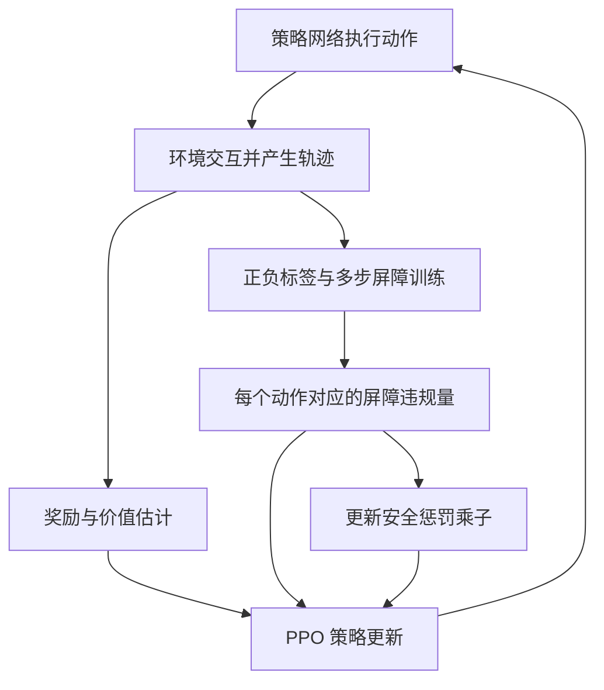

# 《Model-Free Safe Reinforcement Learning Through Neural Barrier Certificate》论文与代码详解

> 阅读目标：弄清楚这篇论文研究什么问题、提出了什么方法、每个公式在做什么、代码怎样实现，以及实验结果能支持什么结论。
>
> 本文依据用户提供的论文全文及本地 `srlnbc` 源码撰写。论文结论、代码实现和用于理解的例子分别标明；没有重新运行训练，实验结果均来自论文。

## 1. 先把这篇论文做的事情说清楚

这篇论文研究的是：**在不知道环境动力学模型的情况下，能否让强化学习智能体既完成任务，又尽量在每一步都不违反安全约束？**

作者同时训练三个网络：

| 网络 | 输入与输出 | 作用 |
| --- | --- | --- |
| 策略网络 $\pi_\theta$ | 状态/观测 → 动作分布 | 决定怎样运动、转向或加速 |
| 奖励价值网络 $V_w$ | 状态/观测 → 预期回报 | 帮助 PPO 判断动作是否有利于完成任务 |
| 神经屏障网络 $B_\phi$ | 状态/观测 → 一个实数 | 学习一个能够持续保持安全的区域，并为策略训练提供安全信号 |

算法在论文和代码里称为 **PPO-Barrier**。它的核心不是把碰撞惩罚简单加进奖励，而是学习一个屏障函数，并要求策略产生的状态转移符合屏障的“不变性条件”。

主要创新有三个：

1. 用交互数据同时学习策略和神经屏障，不要求事先给出屏障的具体函数形式，也不需要用环境模型计算训练梯度。
2. 将单步屏障条件扩展成多步条件，把不同长度的约束加权组合，提高屏障训练的稳定性。
3. 利用动作概率的比值，让已经采集到的屏障违规信号能够更新策略，实现无模型的安全策略优化。

论文在紧急制动、机器人避障和模拟自动驾驶任务中获得了收敛后的近零违规，同时保留了较好的任务性能。

**但它没有完成“训练全过程零违规”或“真实系统上经过严格验证的绝对安全”。** 论文第 VII 节明确承认，神经网络近似误差可能破坏安全条件，训练中仍可能发生违规。

论文信息：Yujie Yang、Yuxuan Jiang、Yichen Liu、Jianyu Chen、Shengbo Eben Li，IEEE Robotics and Automation Letters，2023，8(3)：1295–1302，DOI：[10.1109/LRA.2023.3238656](https://doi.org/10.1109/LRA.2023.3238656)。可参见[作者项目页](https://jjyyxx.github.io/srlnbc/)。

## 2. 它要解决的困难是什么？

### 2.1 普通强化学习关心“任务完成得好不好”

普通强化学习最大化长期回报：

$$
\max_\pi\;\mathbb E\left[\sum_{t=0}^{\infty}\gamma^t r(x_t,u_t)\right].
$$

其中 $x_t$ 是状态，$u_t$ 是动作，$r$ 是奖励，$\gamma$ 是折扣因子。

如果机器人绕开障碍物会让路线更长，而撞过去仍能获得较高奖励，那么只追求回报的策略可能选择危险动作。即使奖励里有碰撞惩罚，也只是让策略在收益和惩罚之间做权衡，并不自动形成逐步安全保证。

### 2.2 限制平均碰撞成本，仍可能留下违规

很多安全强化学习方法把问题写成约束马尔可夫决策过程（CMDP）：

$$
\max_\pi J_r(\pi),\qquad
\text{s.t. }\mathbb E\left[\sum_t\gamma^t c_t\right]\le d,
$$

其中 $c_t$ 是安全成本，例如碰撞记为 1，没有碰撞记为 0。

当 $d>0$ 时，目标本来就容许一定成本。作者进一步指出：即使把阈值设成 0，实际的采样、函数近似和数值优化也未必能消除违规；当碰撞越来越少，成本信号会非常稀疏，很难继续学出准确的风险估计。

这里应区别数学目标和算法实现：**如果非负成本的真实期望严格为 0，确实可以排除对应的正成本事件；困难在于有限样本和近似训练是否真正达到这个条件。** 不能把论文的实践批评理解为“期望约束在数学上永远不能表达零违规”。

### 2.3 安全控制工具有理论结构，但常依赖模型或手工设计

屏障证书可以刻画一个“进去之后不会离开”的安全区域。但传统做法常需要：

- 已知动力学 $x_{t+1}=f(x_t,u_t)$，以计算动作对下一状态的影响。
- 手工指定屏障函数的形式，再调整参数。

复杂机器人或车辆很难获得足够准确的模型；手工屏障又可能过于保守，把本来可以安全完成任务的动作排除掉。

因此，论文希望保留屏障证书的安全结构，同时让屏障的形状和策略都由数据学习。

## 3. 最关键的概念：当前安全，不等于持续可行

### 3.1 论文的系统和安全约束

论文第 III 节首先考虑离散时间、确定性环境：

$$
x_{t+1}=f(x_t,u_t).
$$

“无模型”不是说系统没有动力学，而是说算法不需要知道或学习 $f$，也不需要通过 $f$ 反向传播梯度。

安全由状态约束表示：

$$
h(x_t)\le0,\quad\forall t\ge0.
$$

于是：

$$
X_{\mathrm{safe}}=\{x:h(x)\le0\},\qquad
X_{\mathrm{unsafe}}=\{x:h(x)>0\}.
$$

这些集合描述的是当前时刻是否违规。

### 3.2 为什么需要“持续可行”？

用紧急制动举例，状态是距墙距离 $s$ 和速度 $v$。

只看当前是否碰撞，只需 $s\ge0$。但如果距离很短、速度很快，车虽然现在没有碰墙，却已经无法在撞墙前停下。

为了直观说明，假设连续时间近似下最大制动减速度为 $2\,\mathrm{m/s^2}$，车速为 $5\,\mathrm{m/s}$，最短停车距离为：

$$
d_{\mathrm{stop}}=\frac{v^2}{2a_{\max}}=6.25\,\mathrm m.
$$

- 距墙 8 米：当前安全，而且存在能够避免碰撞的制动方案。
- 距墙 4 米：当前仍没碰撞，但仅靠上述制动能力已经来不及停车。

这个数值例子用于理解概念；本地环境使用离散时间更新，精确停车距离还受到时间步长影响。

论文把“从状态 $x$ 出发，执行指定策略 $\pi$ 后，未来所有时刻都安全”称为 **endless feasibility，持续可行性**：

$$
\forall t\ge0:\quad x_t\in X_{\mathrm{safe}},\quad
u_t=\pi(x_t),\quad x_0=x.
$$

这一定义依赖策略。同一个状态，对一个会及时制动的策略可能可行，对一个持续加速的策略可能不可行。

还要区分：

- **存在某个策略能保持安全**：描述系统在控制能力范围内的可行性。
- **当前这个策略能保持安全**：论文的 $B^\pi$ 要证明的事情。

因此，学到的屏障区域不一定是系统最大的可行区域。

## 4. 神经屏障证书到底是什么？

### 4.1 一个带有时间约束的实值函数

屏障证书 $B^\pi(x)$ 是一个实值函数。论文采用的符号约定是：

$$
X_B^\pi=\{x:B^\pi(x)\le0\}.
$$

非正值一侧是希望认证为可行的区域；正值一侧处于这个认证区域之外。

**$B(x)$ 不是碰撞概率，也不一定是距离。** 它的正负和沿轨迹的变化必须一起看。不同屏障函数可以具有不同数值尺度，但给出相同的零边界。

同样，$B(x)>0$ 不等于“任何策略都救不了这个状态”：它首先意味着该状态没有被当前屏障的非正区域覆盖。

### 4.2 三个性质分别保证什么？

论文定义 2 要求：

**性质一：初始状态位于认证区域内。**

$$
\forall x\in X_{\mathrm{init}},\quad B^\pi(x)\le0.
$$

只有从区域内部出发，后面的不变性证明才接得上。论文假定初始集合属于当前安全集合，但“初始时安全”本身还不能证明未来安全。

**性质二：真正不安全的状态必须在认证区域外。**

$$
\forall x\in X_{\mathrm{unsafe}},\quad B^\pi(x)>0.
$$

这意味着 $X_B^\pi$ 不会包含已经违反安全约束的状态。

**性质三：执行策略后，屏障值满足不变性条件。**

$$
B^\pi(x_{t+1})-B^\pi(x_t)
\le-\alpha(B^\pi(x_t)).
$$

论文取 $\alpha(z)=\lambda z$，其中 $0<\lambda<1$，于是：

$$
\boxed{B^\pi(x_{t+1})\le(1-\lambda)B^\pi(x_t)}.
$$

这个条件并不要求屏障值每一步都减小。例如 $\lambda=0.1$、当前 $B(x_t)=-1$，下一步允许上升到 $-0.9$，但不能上升到 $-0.7$，更不能跨到正值。

它限制的是接近零边界的速度，而不是强迫机器人始终远离边界。

### 4.3 为什么这能证明安全？

如果初始时 $B(x_0)\le0$，那么：

$$
B(x_1)\le(1-\lambda)B(x_0)\le0.
$$

递推得到：

$$
B(x_t)\le(1-\lambda)^t B(x_0)\le0.
$$

所以整个轨迹始终留在 $X_B^\pi$ 内。性质二又保证不安全状态满足 $B>0$，因此轨迹不会进入不安全集合。

这就是 **前向不变性**：从集合内部出发，在给定控制策略下，未来状态始终在集合内部。

这段推导的前提是三个性质在相关状态与转移上确实成立。后文用样本训练网络，是在近似满足这些性质；样本损失很小不等于已经证明了这些全称条件。

## 5. 没有动力学模型，怎样学习屏障？

### 5.1 用策略与环境交互收集数据

策略执行动作，环境返回下一状态和奖励。由此得到轨迹：

$$
D=\{(x_t,u_t,r_t,x_{t+1},\ldots)\}.
$$

训练屏障时，已经知道采样到的 $x_t$ 和 $x_{t+1}$，所以可以直接计算两者的屏障值，不需要模型预测下一状态。

论文还定义两个监督集合：

- $D_{\mathrm{init}}$：样本中属于初始状态集合的状态。
- $D_{\mathrm{unsafe}}$：样本中属于不安全集合的状态。

轨迹中的其他状态，即使没有上述监督标签，也可以参与不变性损失。

### 5.2 把三个性质写成三个损失

令 $[z]_+=\max(z,0)$，屏障由神经网络 $B_\phi$ 表示。下面暂时省略表示策略依赖的上标 $\pi$。

**初始集合损失，对应论文式（4）：**

$$
J_{\mathrm{Edls}}(\phi)
=\frac1{|D_{\mathrm{init}}|}
\sum_{x\in D_{\mathrm{init}}}[B_\phi(x)]_+.
$$

如果初始状态被网络放到正值一侧，就产生损失，推动该输出变成非正值。

**不安全集合损失，对应式（5）：**

$$
J_{\mathrm{Infs}}(\phi)
=\frac1{|D_{\mathrm{unsafe}}|}
\sum_{x\in D_{\mathrm{unsafe}}}[-B_\phi(x)]_+.
$$

如果不安全状态被错误地放到负值一侧，就产生损失，推动其输出向正值方向变化。

**单步不变性损失，对应式（6）：**

$$
J_{\mathrm{Invt}}^1(\phi)
=\frac1{|D|}\sum_t
\left[B_\phi(x_{t+1})-(1-\lambda)B_\phi(x_t)\right]_+.
$$

如果下一状态的屏障值上升得太快，就惩罚这对状态的屏障输出。

三个损失相加：

$$
J_B=J_{\mathrm{Edls}}+J_{\mathrm{Infs}}+J_{\mathrm{Invt}}^1.
$$

第一项和第二项给网络提供正负方向的锚点，第三项让网络根据真实轨迹学习动态边界。它因此不只是一个“当前是否碰撞”的二分类器。

### 5.3 一个容易忽略的公式细节

理论定义要求不安全状态严格满足 $B>0$，但论文式（5）的零损失只要求 $B\ge0$。如果把这些无裕量的损失机械地照搬，恒等于 0 的屏障会使三项损失都为 0，却不满足严格的不安全分离条件。

本地代码用正裕量处理了这个问题：可行标签要求 $B\le-\varepsilon_B$，不可行标签要求 $B\ge\varepsilon_B$。因此，解释算法时需要同时看论文的性质定义和代码中的实际损失，不能仅把“损失等于零”当作证书成立。

## 6. 多步不变性：这篇论文最重要的训练改进

### 6.1 从单步递推到多步

设 $q=1-\lambda$。连续应用单步条件，可以得到：

$$
B(x_{t+n})\le qB(x_{t+n-1})\le\cdots\le q^nB(x_t).
$$

于是定义 $n$ 步损失，论文式（9）：

$$
J_{\mathrm{Invt}}^n(\phi)
=\frac1{|D|}\sum_t
\left[B_\phi(x_{t+n})-q^n B_\phi(x_t)\right]_+.
$$

实际计算只使用存在对应后续状态的轨迹片段，并需要正确处理片段末端和回合边界。

它检查：从当前状态走过 $n$ 步，轨迹是否仍符合屏障值的收缩上界。

### 6.2 为什么单步条件还不够好训练？

理论上，如果每个相关状态的单步条件都准确成立，多步条件自然成立。增加多步损失不是另一个更强的安全定理，而是为了改善有限数据下的学习。

训练早期的屏障估计不准确，单步损失又用网络自身的估计去约束自身，作者将这种现象类比为强化学习中的自举学习：

- 单步联系局部，错误估计可能需要许多次更新才传到更早的状态。
- 多步直接把当前状态与更远的状态连接起来，帮助传播未来的风险信号。
- $q^n$ 随步数增大而减小，作者据此解释多步对部分估计偏差的缓解。
- 更长的轨迹同时引入更多采样变化，方差和计算量也会上升。

“降低偏差、增加方差”是论文的解释，与 $n$ 步 TD 学习的现象相似；它不是本文另外证明的统计误差上界。

### 6.3 把多种步数加权组合

论文不只使用某一个 $n$，而是组合 $1$ 到 $N$ 步：

$$
\boxed{
J_{\mathrm{Invt}}^\gamma(\phi)
=\sum_{n=1}^{N}w_nJ_{\mathrm{Invt}}^n(\phi),\qquad
w_n=\frac{\gamma^{n-1}}{\sum_{m=1}^{N}\gamma^{m-1}}
}.
$$

权重和为 1，远期项按指数衰减。最终屏障损失是：

$$
J_B=J_{\mathrm{Edls}}+J_{\mathrm{Infs}}+J_{\mathrm{Invt}}^\gamma.
$$

论文主要实验取 $N=20$、$\lambda=0.1$、$\gamma=0.99$。例如 20 步系数为：

$$
q^{20}=0.9^{20}\approx0.1216.
$$

假设当前 $B(x_t)=-1$，20 步后的上界就是约 $-0.1216$。同时，算法还检查 1、2、3 等所有中间步数，不会只看第 20 步而忽略中间是否越界。

这里有两个容易混淆的概念：

- $\lambda$ 是屏障不变性参数，对应代码 `barrier_lambda`。
- PPO 中 GAE 的参数也经常叫 $\lambda$，对应代码 `lambda`，它用于估计奖励优势。

二者含义不同。此外，$N=20$ 指利用已采集的 20 步轨迹计算损失，**不是使用模型向前规划 20 步的 MPC**。

## 7. 屏障学出来以后，怎样约束策略？

### 7.1 先理解这里的梯度困难

屏障训练只需改变 $\phi$，对 $B_\phi(x_t)$ 求导即可。

但要改变动作策略 $\theta$，如果直接把屏障写成：

$$
B_\phi(f(x_t,\pi_\theta(x_t))),
$$

通常需要知道动作如何影响下一状态，也就是需要 $f$ 的模型及相应导数。

论文采用另一条路线：对于已经采集到的动作，如果其后续轨迹出现屏障违规，就降低策略以后选择这种动作的概率。

### 7.2 PPO 负责提高任务回报

数据由旧策略 $\pi_{\mathrm{old}}$ 采集。定义动作概率比：

$$
\rho_t(\theta)=
\frac{\pi_\theta(u_t\mid x_t)}{\pi_{\mathrm{old}}(u_t\mid x_t)}.
$$

奖励优势 $\hat A_t$ 衡量这个动作相对于该状态的通常水平，是否获得更好的长期回报。

PPO 最大化，论文式（12）：

$$
J_\pi(\theta)
=\frac1{|D|}\sum_t
\min\left(
\rho_t\hat A_t,
\operatorname{clip}(\rho_t,1-\epsilon_{\mathrm{PPO}},1+\epsilon_{\mathrm{PPO}})\hat A_t
\right).
$$

裁剪用于限制一次策略更新的幅度。

### 7.3 用屏障违规构造安全代理目标

为了把论文式（13）—（14）中简写的 $\rho J_{\mathrm{Invt}}^\gamma$ 展开，可以先为每个采样时刻定义：

$$
g_t=\sum_{n=1}^{N}w_n
\left[B_\phi(x_{t+n})-q^nB_\phi(x_t)\right]_+.
$$

策略的安全代理量可理解为：

$$
C(\theta;D)=\frac1{|D|}\sum_t\rho_t(\theta)g_t.
$$

注意：这里应把每条样本的概率比与该样本的违规量对应起来，不能先把所有违规量平均，再随意乘一个概率比。

固定当前批次的 $g_t$，其策略梯度为：

$$
\nabla_\theta C
=\frac1{|D|}\sum_t
g_t\rho_t(\theta)\nabla_\theta\log\pi_\theta(u_t\mid x_t).
$$

因此，安全优化只需要动作的概率和轨迹上的屏障值，无需计算动力学导数。

直观地说：一次动作虽然尚未造成碰撞，但如果它让未来屏障值上升得太快，也会被降低概率。这提供了比“撞了才记 1 分成本”更提前的训练反馈。

不过，反馈是否提前且准确取决于屏障是否已经学好；它不是一个天然可靠的风险真值。

### 7.4 拉格朗日乘子平衡奖励与安全

论文把问题写成：

$$
\max_\theta J_\pi(\theta),\qquad C(\theta)\le0,
$$

并构造：

$$
\min_{\nu\ge0}\max_\theta
L(\nu,\theta)=J_\pi(\theta)-\nu C(\theta).
$$

$\nu$ 是安全惩罚强度。策略更新既提高奖励，又降低屏障违规；存在违规时，乘子更新提高安全项的权重。

这里 $g_t$ 是非负的，所以 $C\le0$ 的理想目标实际上要求违规量为 0。对于一般非负违规目标，乘子并不会因为一个负违规量自动下降；代码的默认裁剪设置也会使用于乘子更新的量非负。

奖励价值网络则拟合回报目标，论文式（15）：

$$
J_V(w)=\frac1{|D|}\sum_t
\left(V_w(x_t)-(\hat A_t+V_{\mathrm{old}}(x_t))\right)^2.
$$

它帮助奖励优化，屏障网络负责安全结构，两者不是同一个函数。

### 7.5 为什么称为“联合学习”？

屏障依赖策略产生的轨迹，策略又受屏障约束，两者互相影响：



这也意味着，针对某个旧策略学到的屏障不能未经检查就拿来为一个新策略提供完整证明；训练要不断用新策略的数据更新二者。

### 7.6 单步概率比是代理更新，不能当作完整轨迹证明

这里使用的是旧策略轨迹上的局部策略更新。多步违规量涉及后续多个动作，而一个动作的概率比并不等于整段轨迹的完整重要性采样权重，也没有完整修正新策略的状态分布。

因此，更准确的理解是：**它用 PPO 风格的局部代理目标优化安全行为**，不应把这个概率比解释为已经精确评估新策略下所有长期安全事件。

这与论文的局限性一致：算法在实验上获得近零违规，但没有给出任意随机策略、任意分布偏移下的逐轨迹安全认证。

## 8. 一轮完整训练按什么顺序进行？

论文 Algorithm 1 的流程可以用下面的伪代码理解：

```text
初始化策略参数 θ、奖励价值参数 w、屏障参数 φ、安全乘子 ν

重复：
    1. 固定当前策略，采集若干回合的交互轨迹
    2. 计算奖励优势与价值训练目标
    3. 找出初始集合样本和不安全样本
    4. 根据屏障值计算各步数的违规量
    5. 更新安全乘子

    对当前数据进行多次梯度更新：
        6. 更新策略：提高 PPO 回报目标，降低安全代理目标
        7. 更新奖励价值网络：拟合回报
        8. 更新屏障网络：满足标签约束与多步不变性

    9. 用更新后的策略再次采样
```

从信息流看：奖励告诉策略“什么动作更有用”；屏障告诉策略“哪些轨迹变化不符合持续安全的要求”；乘子调节两种目标的相对强度。

训练完成后，动作主要由策略网络给出。论文和本地代码的核心路径没有在每一步额外求解一个基于屏障的安全 QP。屏障主要通过训练过程改变策略，而不是在线逐步修正每一个危险动作。

## 9. `srlnbc` 具体实现了什么？

### 9.1 技术结构和主要入口

本地代码使用 TensorFlow/Keras 和 Ray RLlib。环境文件列出 Python 3.8、TensorFlow 2.8.2、Ray 1.13.0、Gym 0.21.0；这是提供的复现环境版本信息，本文没有验证该环境在当前机器上的可运行性。

| 功能 | 代码位置 |
| --- | --- |
| PPO-Barrier 配置与 Trainer | [ppo_barrier.py](/Users/johann/project/work_based_on_spvc/srlnbc/srlnbc/agents/safety/ppo_barrier/ppo_barrier.py) |
| 屏障损失、策略损失、轨迹处理、乘子更新 | [ppo_barrier_tf_policy.py](/Users/johann/project/work_based_on_spvc/srlnbc/srlnbc/agents/safety/ppo_barrier/ppo_barrier_tf_policy.py) |
| 策略、价值、屏障三个输出分支 | [safety_certificate_fcnet.py](/Users/johann/project/work_based_on_spvc/srlnbc/srlnbc/models/tf/safety_certificate_fcnet.py) |
| 分支构造与输出层 | [misc.py](/Users/johann/project/work_based_on_spvc/srlnbc/srlnbc/models/tf/misc.py) |
| GAE 和训练字段 | [mixin.py](/Users/johann/project/work_based_on_spvc/srlnbc/srlnbc/agents/safety/mixin.py) |
| 采样、乘子更新、网络训练的执行顺序 | [ppo_lagrangian.py](/Users/johann/project/work_based_on_spvc/srlnbc/srlnbc/agents/safety/ppo_lagrangian/ppo_lagrangian.py)、[execution_ops.py](/Users/johann/project/work_based_on_spvc/srlnbc/srlnbc/agents/safety/execution_ops.py) |
| 紧急制动与机器人环境 | [car_brake.py](/Users/johann/project/work_based_on_spvc/srlnbc/srlnbc/env/car_brake.py)、[unicycle.py](/Users/johann/project/work_based_on_spvc/srlnbc/srlnbc/env/unicycle.py) |
| Safety Gym 观测与标签 | [simple_safety_gym.py](/Users/johann/project/work_based_on_spvc/srlnbc/srlnbc/env/simple_safety_gym.py) |
| MetaDrive 环境与标签规则 | [my_metadrive.py](/Users/johann/project/work_based_on_spvc/srlnbc/srlnbc/env/my_metadrive.py)、[metadrive_rules.py](/Users/johann/project/work_based_on_spvc/srlnbc/srlnbc/env/metadrive_rules.py) |
| Safety Gym 与驾驶训练入口 | [ppo_barrier_safety_gym.py](/Users/johann/project/work_based_on_spvc/srlnbc/examples/ppo_barrier_safety_gym.py)、[ppo_barrier_metadrive.py](/Users/johann/project/work_based_on_spvc/srlnbc/examples/ppo_barrier_metadrive.py) |
| 屏障图、学习曲线和消融绘图 | [examples/plot](/Users/johann/project/work_based_on_spvc/srlnbc/examples/plot) |

`PPOBarrierTrainer` 继承 `PPOLagrangianTrainer`，复用 PPO 的采样和训练组织方式，但使用专门的 `PPOBarrierTFPolicy` 和屏障网络。它不是简单地调用原有的成本价值网络完成安全学习。

### 9.2 三个网络分支及实际配置

Safety Gym 和 MetaDrive 示例的配置为：

- 策略隐藏层：两层，每层 256 个单元，Tanh 激活。
- 奖励价值分支：在 `vf_share_layers=False` 时使用独立隐藏层。
- 屏障分支：同样使用独立隐藏层，但代码指定隐藏激活为 ELU，末端输出一个无激活的实数。
- 动作分布使用可训练的对数标准差设置。

因此，论文表 I 对隐藏层激活给出的 Tanh 概述，不能直接理解成代码所有分支都使用 Tanh。

两个经典控制示例使用 `[128, 128]`，不是统一的 `[256, 256]`。

### 9.3 重要差异一：代码用的是环境提供的可行/不可行标签

论文公式里的监督集合是 $D_{\mathrm{init}}$ 和 $D_{\mathrm{unsafe}}$。代码实际从环境的 `info` 读取：

```text
cost        安全成本，用于记录和评估
feasible    可行方向的监督标签
infeasible  不可行方向的监督标签
```

这些标签不是仅由“是否是回合第一步”和“是否已经碰撞”决定。

**Safety Gym 示例：** 代码先计算预计碰撞时间 TTC（time to collision），主要根据当前速度方向与障碍物几何关系估计保持当前运动时的碰撞时间。

- 没有预测到碰撞，或者 TTC 大于 2 秒：标为可行方向。
- TTC 在 0 到 1 秒之间：标为不可行方向。
- TTC 在 1 到 2 秒之间：不提供这两类确定标签。

环境还支持距离阈值：明确进入危险距离时直接给不可行标签。没有正负标签的状态仍可参与轨迹不变性训练。

**紧急制动：** 采用 TTC 大于 3 秒等可行标签，以及 TTC 不超过 0.5 秒等不可行标签。

**MetaDrive 示例：** 综合使用碰撞/出路/到达终点信息，以及车速、周围对象 TTC、道路朝向等规则。所配置规则全部认可才给可行标签，只要任一规则明确判为不可行就给不可行标签。

这些是训练的监督信号，并不自动等价于“经过数学证明的无限时域可行/不可行真值”。特别是 TTC 较小，可能仍然存在急转向或急制动的避险策略。

所以，**代码不预设神经屏障的函数形式，但仍使用人为设定的安全标签规则和阈值。** 这与“需要手工写出整个屏障函数”不同，也不能被理解为“完全没有安全先验”。

### 9.4 重要差异二：实际损失加入正裕量

令 $\varepsilon_B$ 表示代码的 `epsilon`，其默认及示例值是 0.01；它不是 PPO 的 `clip_param`。

标签损失实际为：

$$
J_{\mathrm{feasible}}^{\mathrm{code}}
=\operatorname{mean}_{x:\,\mathrm{feasible}=1}
[\varepsilon_B+B_\phi(x)]_+,
$$

$$
J_{\mathrm{infeasible}}^{\mathrm{code}}
=\operatorname{mean}_{x:\,\mathrm{infeasible}=1}
[\varepsilon_B-B_\phi(x)]_+.
$$

分别推动输出到 $-0.01$ 以下和 $+0.01$ 以上，避免只在零附近勉强分开。

代码的 $n$ 步不变性损失还加入累计裕量：

$$
\left[
B_\phi(x_{t+n})-q^nB_\phi(x_t)
+\varepsilon_B\frac{1-q^n}{\lambda}
\right]_+.
$$

其含义可以从更严格的单步条件看出：

$$
B(x_{t+1})\le qB(x_t)-\varepsilon_B.
$$

递推 $n$ 步就得到：

$$
B(x_{t+n})\le q^nB(x_t)
-\varepsilon_B\sum_{k=0}^{n-1}q^k
=q^nB(x_t)-\varepsilon_B\frac{1-q^n}{\lambda}.
$$

因此，这个额外项是逐步裕量累积的结果。对正值侧的分离和转移约束都增加裕量，并不意味着已经完成全状态验证。

### 9.5 重要差异三：策略安全项和屏障损失的处理不完全相同

`postprocess()` 用采样时的屏障值计算 `penalty_margin`：

$$
p_t=\sum_{n=1}^{N}w_n\max\left(
\varepsilon_B\frac{1-q^n}{\lambda}
+B_{\mathrm{old}}(x_{t+n})-q^nB_{\mathrm{old}}(x_t),\ c_{\min}
\right).
$$

示例的 `penalty_margin_clip` 为 0，因此这一步取的是非负违规量。该量随后固定在当前训练批次里，用于策略和乘子更新。

策略损失内部又把它减去均值、除以标准差，得到 $\tilde p_t$。简化掉价值损失、熵项和 KL 项后，代码最小化的策略部分是：

$$
\mathcal L_{\mathrm{policy}}
=\frac{-J_{\mathrm{PPO}}+\nu\operatorname{mean}(\rho_t\tilde p_t)}{1+\nu}.
$$

这相当于给奖励优势配上一个安全方向的代理信号：相对更危险的动作受到抑制，相对更安全的动作可以得到鼓励。

标准化后的量可能为负，因此代码用于策略梯度的目标，不再是论文中未经处理的非负约束量本身。乘子更新仍使用标准化之前的 `penalty_margin`。

屏障损失则使用当前网络重新计算的屏障值，继续更新 $\phi$。这体现了两类优化的区别：

- 更新屏障时，对屏障输出求导，调整安全边界。
- 更新策略时，对动作概率求导，调整动作分布。

### 9.6 乘子、批次顺序和回合边界

代码通过 `softplus` 将乘子参数变成正数；在每轮网络训练前，先更新乘子。`max_penalty` 用于限制继续增大乘子：实现是超过阈值后停止更新，不是每次严格裁剪到该阈值。

多步屏障训练需要保留轨迹顺序。示例把 `sgd_minibatch_size` 设成 0，采用整批训练。若移植时随机打乱单步样本，再把数组中相邻位置当作相邻状态，会破坏多步损失的含义。

在屏障损失里，代码用 `episode_mask` 排除跨采样片段边界的转移，并逐步扩大多步掩码；用于策略的预处理也只计算片段中存在的后续状态。片段末尾能使用的步数更少，而权重仍使用配置的全局归一化系数。

这些处理不能直接代表任意环境下的终止安全语义。移植时尤其要核对：失败终止、成功终止、时间上限截断以及末步观测，是否都和标签、轨迹索引正确对应。本文做的是方法与源码阅读，没有将这些实现细节作为已经通过运行验证的结论。

## 10. 实验实现了什么？结果怎么看？

### 10.1 经典控制：检查屏障边界是否有物理意义

**紧急制动任务，论文图 3：**

- 状态：距墙距离和车速。
- 动作：加速度。
- 奖励：向墙接近的距离，鼓励在安全前提下靠近墙。
- 回合上限：200 步。

利用已知制动能力，可以画出理论停车边界。论文的神经屏障零边界与该边界接近，说明屏障学到的不只是墙的位置，还与速度和制动能力有关。采样较少的区域误差更明显。

本地 `car_brake.py` 用连续制动距离关系 $v=\sqrt{2a_{\max}s}$ 绘制参照线，而环境采用离散步进；该图是直观参照，不应被当作对每个离散状态的严格形式化验证。

**到达目标并避障，论文图 4：**

- 状态：位置、速度和航向。
- 动作：加速度和角速度。
- 奖励：到目标距离的减少量。
- 回合上限：100 步。

论文用最大转向与减速策略在密集网格上模拟，生成可行边界参照。学到的区域形状与参照接近，但稍微保守。这里的参照来自模拟控制方案，应与紧急制动的解析参照区分。

### 10.2 Safety Gym：检查安全和任务性能能否兼顾

论文使用 Point Goal、Car Goal、Doggo Goal 三个环境。机器人要到达目标，同时避免进入危险区域；Doggo 需要控制 12 个电机，状态还包含关节和接触信息。

比较对象包括：

| 方法 | 核心特征 |
| --- | --- |
| PPO | 不带显式安全约束 |
| PPO-Lagrangian | 用乘子约束累计安全成本 |
| TRPO-Lagrangian | 在 TRPO 中处理成本约束 |
| CPO | 通过约束策略优化处理成本限制 |
| FAC-SIS | 联合学习策略和具有预设函数形式的安全证书 |
| PPO-Barrier | 学习神经屏障，并用多步不变性约束策略 |

论文把 CMDP 基线的成本阈值设为 0。主要指标是每回合安全成本和每回合回报；图 6 给出三次运行的均值及 95% 置信区间。

实验支持的主要结论是：

- PPO-Barrier 在三类任务中达到收敛后的近零违规。
- 相比受约束基线，它保持了较好的回报，尤其在较复杂的 Doggo 任务中优势更明显。
- FAC-SIS 在部分环境也能获得近零违规，但回报更低，在 Doggo 中安全曲线出现明显峰值。
- 普通 PPO 的回报可以更高，同时违规也明显更多；论文并没有证明 PPO-Barrier 在所有指标上全面超过 PPO。

不能把图中的接近零均值解释成所有轨迹、所有状态或所有随机种子都被证明零违规。

### 10.3 屏障可视化：它学到了运动方向的影响

图 7 固定机器人的速度、方向和其他部分状态，再扫描平面位置，绘制 $B=0$ 等值线。

同一个障碍物，在机器人向左运动和向右运动时，其前方不可行区域的位置不同。这表明网络输出不仅与障碍位置有关，还捕捉到了速度方向及运动特征。

但是，这些图只是高维状态空间的切片。Doggo 的关节状态和接触力在绘图时被简化为零，可能偏离训练分布，因此图形较不规则。论文对此有明确说明。

### 10.4 多步消融：不是一个无关紧要的附加项

图 8 在 Point Goal 比较 $N=1,5,10,20$：

- 只用单步损失时，实验中的违规难以消除。
- 使用 5 步及以上时，能够达到近零违规。
- 较大的步数整体改善了回报与训练表现，但计算量增加。

这支持“多步损失有助于学习”的结论，不等于证明任何环境都必须选 20 步，也不等于理论上单步证书不成立。

### 10.5 MetaDrive：把方法扩展到复杂驾驶观测

论文使用 10 个不同路网的模拟驾驶任务。车辆观测包含自身状态、导航点和周围对象的激光雷达信息，动作是转向与加减速。

它比较 PPO-Lagrangian、TRPO-Lagrangian、CPO 和 PPO-Barrier。图 10 使用到达目的地的成功率与每回合安全成本作为指标。

论文报告 PPO-Barrier 获得近零违规、成功率超过 0.8；成功率与 TRPO-Lagrangian 相当，优于 CPO 和 PPO-Lagrangian。

这说明方法在该模拟驾驶配置中能够兼顾任务完成和碰撞减少。虽然 MetaDrive 可以生成许多地图，本次实验使用的是有限路网配置，不构成对任意道路、真实交通或视觉输入的泛化证明。

## 11. 关键参数怎样理解？

以下是论文表 I 和本地示例中需要区分的设置：

| 参数 | 论文主要设置 / 本地示例 | 含义 |
| --- | --- | --- |
| 网络隐藏层 | 表 I：2 层，每层 256；经典控制代码：128×128 | 函数近似容量 |
| 奖励折扣 $\gamma$ | 0.99 | 长期奖励的权重；代码也用于多步屏障加权 |
| 网络学习率 | $3\times10^{-4}$ | 策略、价值和屏障训练的更新速度 |
| GAE 参数 | 表 I 和 Safety Gym 示例：0.97；驾驶示例：0.95 | 奖励优势估计的偏差与方差折中 |
| PPO 裁剪参数 | 表 I：0.2 | 限制策略概率比的更新幅度 |
| 屏障 $\lambda$ | 0.1 | 控制 $B_{t+1}\le(1-\lambda)B_t$ 的上界 |
| 多步上限 $N$ | 表 I、Safety Gym、驾驶示例：20；Trainer 默认和经典控制示例：10 | 使用多长的已采集轨迹构造约束 |
| 屏障裕量 $\varepsilon_B$ | 代码：0.01 | 正负标签分离和不变性安全裕量 |
| 训练批量 | 表 I 和复杂环境示例：20000 | 每次更新收集的交互样本量 |

参数并不是越大越安全。例如增大多步上限会增加计算量与采样变化；改变标签阈值可能显著改变学出的区域；乘子较大也不能保证把一个近似软目标变成严格逐步约束。

## 12. 它有哪些明确的边界？

### 12.1 理想证书的定理，不等于训练网络的完整认证

如果三个性质在所有相关状态上精确成立，就能递推得到持续安全。但实际训练只在采样轨迹上最小化损失，论文没有对整个连续状态空间完成形式化验证。

神经网络可能在未采样位置输出错误；策略更新也可能进入此前数据不足的区域。有限次实验近零违规是有价值的经验结果，但不能替代全状态证明。

### 12.2 主要目标是收敛后安全，训练中允许试错

论文明确假设在仿真中训练，违规不会造成现实损害。训练曲线早期也存在成本。因此，这篇论文不能被直接描述成“无需模型且训练时零碰撞”。

### 12.3 理论设定与随机策略实践需要区别

第 III 节以确定性动力学和 $u=\pi(x)$ 说明证书性质，策略优化和代码则使用带概率分布的 PPO。

对于随机动作，如果要保证每条轨迹安全，需要相应条件覆盖可能采样到的动作及其转移。本文没有给出覆盖全部动作支持集、扰动和噪声的鲁棒证书，也没有提供带明确失败概率的随机安全定理。

### 12.4 无模型仍然需要可用的观测和安全监督

模型自由是关于训练更新不依赖动力学模型，不是关于完全不需要几何、传感器信息或安全定义。

代码的 TTC 与道路规则依赖环境提供的信息。若只能观察图像，或者速度与障碍估计有误，需要进一步处理观测误差；论文没有完成图像端到端的感知误差认证。

### 12.5 没有默认的在线安全兜底

策略在部署时若给出危险动作，训练中使用过屏障并不自动保证动作会被拦截。若应用需要每步强制修正动作，需额外设计安全过滤器，并解决其可行性、模型或误差边界问题；这不是本文已实现的核心算法。

## 13. 常见理解误区

| 容易产生的理解 | 更准确的解释 |
| --- | --- |
| “没有模型，所以没有使用任何规则” | 不需要动力学模型求梯度，但代码使用几何和 TTC 等监督规则 |
| “屏障网络就是碰撞概率预测器” | 它输出满足符号和转移约束的实数，不是概率 |
| “安全标签就是真实无限时域可行性” | 代码标签是训练监督，部分来自启发式规则 |
| “多步屏障就是规划未来 20 步” | 它利用已经采集的轨迹构造训练损失 |
| “只需让屏障值逐步下降” | 在负值区域允许受限上升，关键是保持非正区域不变 |
| “学到了一个屏障就可以认证所有策略” | 屏障与策略及其转移相关，需要针对执行策略满足条件 |
| “近零平均成本就是绝对安全” | 是实验统计表现，不能代替全状态、全轨迹认证 |
| “部署时每一步会用 QP 检查动作” | 本文核心是训练期约束策略，本地实现没有这种逐步 QP |
| “奖励价值网络和屏障网络是同一个东西” | 前者估计任务收益，后者学习安全区域与动态条件 |

## 14. 如何抓住这篇论文的贡献？

理解它时，可以把方法压缩成一条因果链：

**真实交互轨迹提供状态转移 → 正负标签给屏障确定方向 → 多步不变性塑造动态安全边界 → 屏障违规量为动作提供安全反馈 → 动作概率比把反馈传给 PPO → 策略在提高回报时尽量维持持续安全。**

它最有价值的地方，是把“学习安全区域”和“学习高回报动作”连接起来，并且这条训练链不需要对环境动力学求导。

它实际实现的，是一个能够在多个仿真任务中取得收敛后近零违规的联合学习算法。要进一步声称严格安全，还需要补上全状态验证、随机性或扰动处理、观测误差分析，以及部署时的闭环保证。

## 15. 来源与核对位置

- [用户提供的论文 PDF](/Users/johann/project/work_based_on_spvc/Model-Free_Safe_Reinforcement_Learning_Through_Neural_Barrier_Certificate.pdf)：主要依据。
- PDF 第 3 页，印刷页 1297：问题定义、持续可行性、屏障三个性质、式（1）—（8）。
- PDF 第 4 页，印刷页 1298：多步损失、PPO 与拉格朗日目标、Algorithm 1、式（9）—（15）。
- PDF 第 5 页，印刷页 1299：经典控制图、Safety Gym 任务、表 I 超参数。
- PDF 第 6 页，印刷页 1300：Safety Gym 学习曲线、屏障可视化、三次运行与置信区间。
- PDF 第 7 页，印刷页 1301：多步消融、MetaDrive 实验、局限性。
- [本地项目说明](/Users/johann/project/work_based_on_spvc/srlnbc/README.md)与[官方源码仓库](https://github.com/jjyyxx/srlnbc)：仓库出处；本文的实现细节以本地源码为准。
- 第 9 节列出的源码文件：网络结构、损失裕量、标签规则、乘子和轨迹处理的核对位置。

本文没有从曲线中估读精确终值，没有重新训练验证指标，也没有把本地示例配置等同于论文全部实验的实际运行配置。
